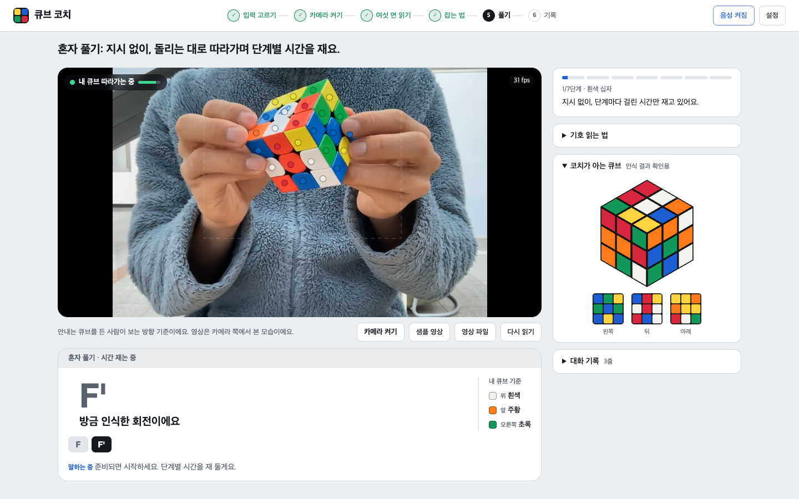
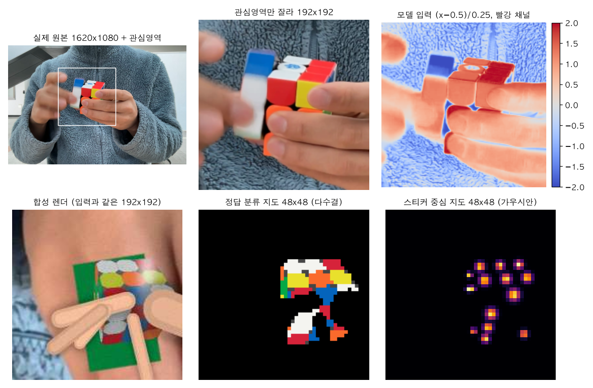
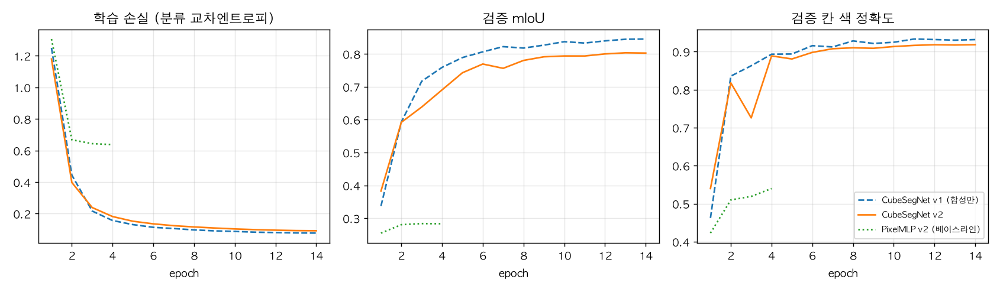
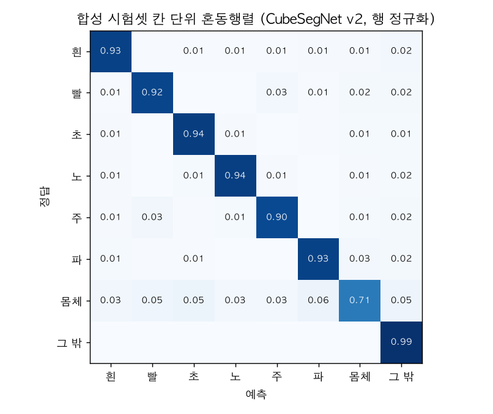
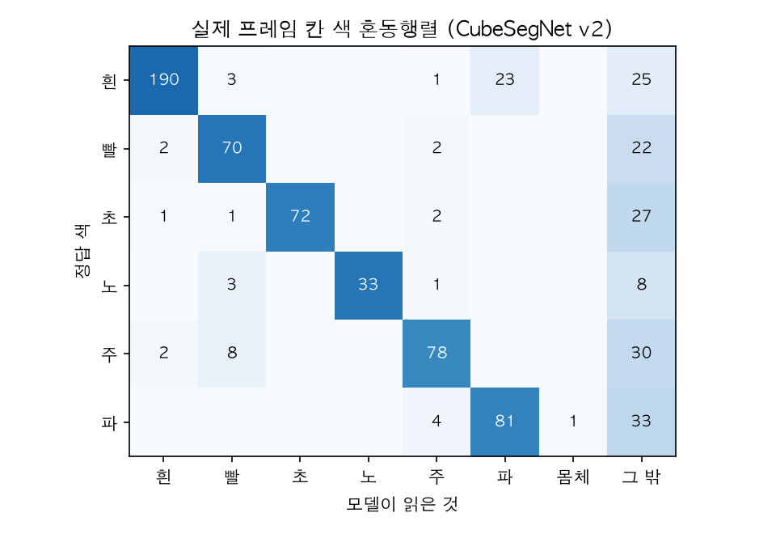
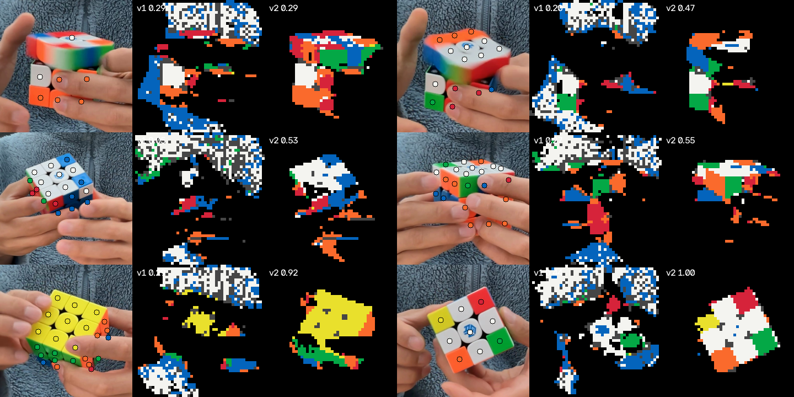
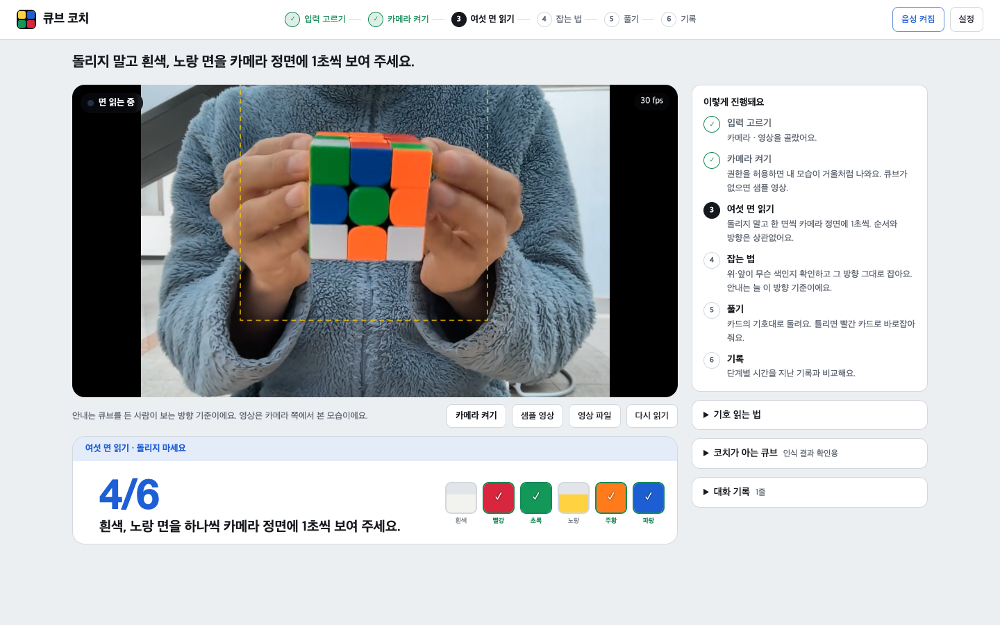
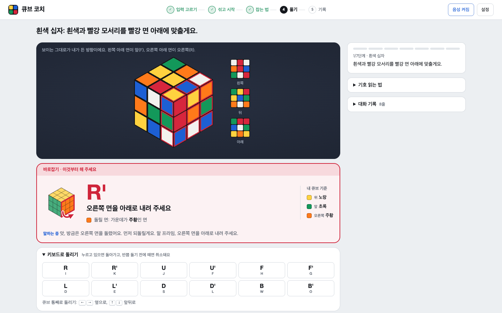
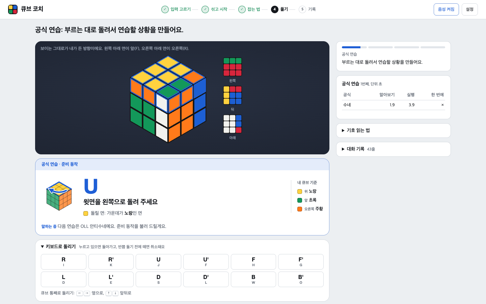

# 큐브 코치

카메라 앞에서 3x3x3 큐브를 돌리면, 돌리는 동안 큐브를 계속 따라가며 지금 단계에 맞는 다음 동작을 한국어 음성으로 알려 주는 웹 서비스입니다.
틀린 면이나 반대 방향으로 돌리기 시작하면 다 돌리기 전에 "잠깐요"라고 말립니다.
카메라 화면에서 큐브 칸을 읽는 인식 모델을 직접 학습했고, 학습한 모델 파일을 브라우저 안에서 실행합니다(서버 없음, 영상은 밖으로 나가지 않음).

데모: https://qwertypotter6873.github.io/cube-coach/



## 0. 프로젝트 정보

| 항목 | 내용 |
|---|---|
| 학번·이름 | 201935607 김대현 |
| 과목 | 가천대학교 기계학습 프로그래밍, 기말 프로젝트 |
| 데모 URL | https://qwertypotter6873.github.io/cube-coach/ |
| GitHub URL | https://github.com/qwertypotter6873/cube-coach |
| 데이터 형태 | 이미지(영상 프레임) — 픽셀 단위 분할 + 스티커 중심 지도 |
| 학습 방식 | 처음부터 학습(Scratch), 3차원 합성 데이터 + 실제 촬영 배경 |
| 최종 모델 | CubeSegNet v2 (인코더-디코더 분할망, 17만 개 가중치, ONNX 664KB) |

**핵심 결과**

| 평가 | 베이스라인 | 합성만 학습(v1) | 최종(v2) |
|---|---:|---:|---:|
| 합성 시험셋 칸 색 정확도 / F1 (1,500장) | PixelMLP 0.551 / 0.697 | 0.930 / 0.944 (v1 시험셋) | **0.918 / 0.933** |
| 실제 프레임 칸 색 정확도 / F1 (40장, 723칸) | PixelMLP 0.484 / 0.550 | 0.331 / 0.453 | **0.725 / 0.799** |
| 실제 프레임 배경 오검출률 | PixelMLP 10.3% | 32.0% | **3.6%** |
| 처음 상태 읽기 (실제 영상 3개) | – | – | 3개 모두 54칸 정답 (7.7초·26.8초·32.9초)† |
| 실제 영상 회전열 정확도, 천천히 — 개발 영상 (28수, 시드 5개)*‡ | – | – | 0.97 ± 0.06 |
| 같은 지표, 문턱을 고른 뒤 찍은 시험 영상, 한 수씩 천천히 (24수 x 2 구간, 시드 5개)* | – | – | **0.79 ± 0.28 / 0.84 ± 0.32** (10번 중 7번은 24수 전부) |
| 같은 지표, 문턱을 고른 뒤 찍은 영상, 빠르게 (24수 x 2 구간, 시드 5개 중앙값)* | – | – | 0.04 / 0.29 |
| 브라우저 처리 속도 (영상 파일 재생) | – | – | **30fps** (모델 + 추적기) |

\* 구간 시작 시점의 정답 상태를 알고 시작한 값. 면 보여 주기·고쳐 잡기부터 이어서 재면 크게 떨어진다. 첫 영상은 중앙값 0.19\~0.23이고, 빠르게 돌린 두 번째 영상은 48수 가운데 1\~4수, 천천히 돌린 세 번째 영상은 앱이 면 읽기를 마치는 시각(32.9초)부터 재면 시드 5개 중 3개가 48수를 모두 맞혔고, 끝 상태는 2개가 맞았다(5.4절).

‡ 문턱을 고른 같은 영상에서 다시 잰 값이고, 정답 회전의 색·방향 일부를 추적기 판정에서 가져왔다(9절 사례 3). 시드 5개는 영상 5개가 아니라 같은 영상에서 추적기 탐색 난수만 바꾼 것이다. 그래서 독립된 시험 성능으로 보지 않는다. 설정을 고정한 뒤 찍고 사람이 프레임만 보고 정답을 정한 시험 영상의 값은 바로 아래 두 줄이다.

† 세 번째 영상은 처음에 실패했고, 그 영상으로 원인을 찾아 고친 뒤의 값이다. 그래서 세 번째 영상의 성공은 처음 보는 영상에서 확인한 것이 아니다. 고치기 전에는 7.7초·31.5초·실패였다(5.3절).

합성 데이터만으로 학습한 v1은 합성 시험셋에서는 좋았지만 실제 화면에서는 쓸 수 없었다(0.33). 실제 촬영에서 자른 배경·피부 조각과 실제 큐브 색을 합성에 넣은 v2로 같은 구조를 다시 학습해 실제 화면에서 쓸 수 있게 됐다. 픽셀 단위 실제 라벨은 하나도 쓰지 않았다.

## 1. 문제 정의

**누가 (Who)**
큐브를 처음 배우거나, 초급 공식으로는 맞출 수 있지만 더 빠른 방법(CFOP)으로 넘어가려는 사람.

**무엇을 (What)**
손에 든 큐브를 카메라로 매 프레임 추적해, 지금 상태(54칸)와 돌리고 있는 층·각도를 알아내고, 수준별 공식에 맞춰 다음 동작을 음성으로 안내하고 바로잡는다.

**언제 (When)**
혼자 연습할 때. 책·영상은 내 큐브 상태를 모르고, 내가 지시대로 돌렸는지도 확인해 주지 않는다.

**왜 (Why)**
초보가 막히는 지점은 "공식을 외웠는데 내 큐브에서 어느 방향으로 들고 해야 하는지 모를 때"와 "한 번 잘못 돌려서 어디서 틀렸는지 모를 때"다. 옆에서 보고 있다가 바로 말해 주는 선생님이 있으면 해결되는 문제다.

**기존 서비스와의 차이**

| | 풀이 앱(사진으로 면 스캔) | 강의 영상·책 | 스마트 큐브(블루투스) | 큐브 코치 |
|---|---|---|---|---|
| 내 큐브 상태를 앎 | 스캔한 순간만 | 모름 | 앎 | 앎 (카메라로 계속) |
| 돌리는 도중을 봄 | 아니오 | 아니오 | 예 | 예 (층 각도까지) |
| 잘못 돌리면 바로 말림 | 아니오 | 아니오 | 앱마다 다름 | 예 (28도 넘으면) |
| 필요한 것 | 휴대폰 | — | 전용 큐브(수만 원) | 웹캠 + 가지고 있는 큐브 |

**정량 목표**

| 대상 | 지표 | 목표 |
|---|---|---|
| 인식 모델 (합성 시험셋) | 칸 색 정확도 | ≥ 0.90 |
| 인식 모델 (실제 촬영 프레임) | 칸 색 정확도 | ≥ 0.85 |
| 추적 (정답을 아는 실제 영상) | 회전열 정확도 | ≥ 0.80 |
| 서비스 | 브라우저 처리 속도 | ≥ 20 fps |

## 2. 데이터


| 이름 | 출처 | 라이선스 | 규모 | 용도 |
|---|---|---|---|---|
| 3D 합성 큐브 장면 v2 | 직접 제작 (`src/cubecoach/render3d.py`) | 본인 저작 | 학습 20,000 / 검증 1,000 / 시험 1,500장 (192x192) | 학습·검증·시험 |
| 실제 촬영 배경 조각 | 직접 촬영 `cube_unsolved.mov` 앞 300초 | 본인 촬영, 공개 ([Release data-v1](https://github.com/qwertypotter6873/cube-coach/releases/tag/data-v1)) | 1,461장 (224x224) | 합성 장면의 배경·손 질감 |
| 실제 프레임 평가셋 | 직접 촬영 `cube_unsolved.mov` 300초 이후 | 본인 촬영, 공개 (Release data-v1) | 40장, 칸 중심 클릭 정답 | 실제 화면 시험 |
| 정답을 아는 회전 영상 | 직접 촬영 `sexy_move.mov` (151초) | 본인 촬영, 공개 (Release data-v1, 앞 46초는 데모 샘플) | 4,526프레임, 정답 회전 53개 | 처음 상태 읽기·추적 시험 |

**합성 데이터를 만든 이유.** 연속 추적에는 "모든 프레임에서 어느 픽셀이 어느 색 칸인지"와 "칸 중심이 어디인지"가 필요하다. 사람이 영상 프레임마다 54칸을 칠하는 것은 불가능하다. 그래서 큐브를 26개 조각의 3차원 모형으로 그려, 무작위 자세·섞인 상태·층을 돌리는 도중의 모습·손가락 가림·조명을 만들고, 정답은 기하에서 바로 계산한다. 라벨링 비용이 0이고 개수에 제한이 없다.

**실제 촬영을 더한 이유.** 합성만으로 학습한 v1 모델은 합성 시험셋에서 칸 정확도 0.93이었지만, 실제 영상에서는 회청색 플리스 옷을 파랑으로, 손을 주황·흰색으로 읽었다. 촬영한 큐브가 검은 테두리가 없는 스티커리스(GAN)였는데 v1 합성에는 검은 몸체 큐브만 있었다. 실제 영상에서 큐브가 없는 조각을 잘라 배경과 손 질감으로 쓰고, 실제 칸 색을 재서 합성 색에 넣은 것이 v2다(3절).

**클래스 구성 (합성 v2 학습셋, 48x48 정답 지도의 칸 비율)**

| 흰 | 빨 | 초 | 노 | 주 | 파 | 큐브 몸체 | 그 밖(배경·손) |
|---:|---:|---:|---:|---:|---:|---:|---:|
| 1.64% | 1.64% | 1.62% | 1.62% | 1.63% | 1.62% | 1.59% | 88.65% |

스티커 여섯 색은 고르게 나뉘고(섞인 상태를 무작위로 만들기 때문), "그 밖"이 대부분이다. 그래서 손실에 스티커 칸 가중치 2, 몸체 1, 그 밖 0.5를 준다. 한 장에 중심이 보이는 스티커는 평균 15.8개다.

**분할과 시드.** 합성셋은 학습·검증·시험을 서로 다른 난수 시드(10000 / 20000 / 30000)로 따로 만든다. 같은 장면이 두 분할에 들어갈 수 없다. 실제 촬영은 시간으로 나눴다. 배경 조각은 앞 300초에서만 자르고, 평가 프레임은 그 뒤 130초에서만 고른다. 정답을 아는 회전 영상은 학습에 전혀 쓰지 않았다. 모델 학습 시드는 42다.

## 3. 데이터 전처리



1. **관심영역 자르기 + 크기 맞춤** (`scripts/track_video.py: crop`, `web/src/vision/seg.ts`). 1620x1080 원본에서 추적기가 예상한 큐브 둘레의 정사각 영역만 잘라 192x192로 줄인다. 큐브가 영역의 절반쯤을 차지하게 되어, 멀리 있는 큐브도 같은 크기로 보인다. 화면 밖으로 나간 부분은 검게 채운다.
2. **정규화** (`src/cubecoach/models.py: _Norm`). 0\~255를 0\~1로 나눈 뒤 (x − 0.5) / 0.25로 옮긴다. 모델 안에 넣어 두어 브라우저에서도 같은 계산이 된다.
3. **정답 지도 줄이기** (`render3d.py: render`). 384x384로 그린 정답을 4x4 칸마다 가장 많이 차지한 분류로 줄여 48x48 지도를 만든다(다수결). 경계가 섞인 칸도 하나의 분류를 갖는다.
4. **스티커 중심 지도** (`render3d.py: render`). 중심이 가려지지 않은 스티커마다 크기에 비례하는 가우시안을 찍는다. 추적기가 칸 위치를 칸보다 세밀하게 맞추는 데 쓴다.
5. **실제 배경 조각 고르기** (`scripts/extract_real_bg.py`). 실제 영상에서 무작위 정사각 조각을 자르고, 채도가 아주 높은 픽셀(큐브 칸)이 0.2% 넘게 있는 조각은 버린다. 3,600개 중 1,461개가 남았다. 라벨 없이 전부 "그 밖"으로 쓸 수 있다.
6. **색 보정** (`render3d.py: REAL_PALETTE`). 실제 영상의 선명한 프레임에서 채도 높은 픽셀의 색상 분포를 재서 여섯 색의 중앙값을 합성 색으로 쓴다(60%는 실제 색, 40%는 표준 색 + 무작위 흔들기).
7. **증강.** 무작위 자세·크기·위치, 조명 방향, 화이트밸런스, 노출, 반사광, 손가락(실제 피부 질감 50%), 흐림, 한 방향 움직임 번짐(35%), JPEG 압축.

**전·후 비교 (수치)**

| 전처리 | 비교 | 결과 |
|---|---|---|
| 5·6·7. 실제 배경 조각 + 실제 색 + 스티커리스·번짐 증강 (합성 v1 → v2) | 같은 모델 구조·학습 설정(14에폭, 배치 64), 실제 프레임 723칸. 학습 이미지가 16,000 → 20,000장이라 학습 단계도 3,500 → 4,368로 약 25% 많다 | 칸 색 정확도 0.331 → **0.725**, 배경 오검출 32.0% → **3.6%** (5.2절). 데이터 구성과 학습량의 효과를 따로 가른 실험은 아니다 |
| 1. 관심영역 자르기 | 같은 v2 모델, 실제 프레임 723칸 (`scripts/eval_preprocess.py`) | 큐브가 절반 크기로 찍힌 경우(화면 2배 넓게) 0.667 → 화면 전체 0.704 → **관심영역 0.719** |

3·4번(정답 지도 다수결, 중심 지도)은 전후를 견준 실험이 없다. 예전에 이 표에 넣었던 "중심 재현율 0.271 → 0.976"은 같은 정답 지도로 학습한 PixelMLP와 CubeSegNet의 차이라서, 전처리가 아니라 모델의 차이다(5.1절). 2번 정규화는 모델 안의 고정 계산이라, 위 그림의 셋째 칸은 그 값(빨강 채널, −2\~2)을 색으로 보인 것이다.

관심영역 자르기의 효과가 작은 것은, 시험 영상에서는 큐브가 이미 화면 높이의 3분의 1쯤으로 크게 찍혔기 때문이다. 큐브가 작게 찍힐수록(카메라에서 멀수록) 차이가 커진다.

## 4. 모델

| | HSV 규칙 | PixelMLP (베이스라인) | CubeSegNet (제안) |
|---|---|---|---|
| 입력 | 칸 평균색 | 4x4 칸 평균색 | 192x192 영역 전체 |
| 구조 | 색상·채도 임계값 | 1x1 합성곱 3층 | 깊이별 분리 합성곱 인코더(1/16) + 디코더(1/4), 건너뛰기 연결 |
| 출력 | 6색 | 9채널 48x48 | 9채널 48x48 (분류 8 + 중심 지도 1) |
| 가중치 | 없음 | 1,481개 | 170,025개 (ONNX 664KB) |
| 학습 | 없음 | 4 epoch | 14 epoch, AdamW, OneCycle(최대 4e-3), 배치 64 |

**왜 이 구조인가.**
- 칸 하나의 색만 보면 손·옷·조명 때문에 헷갈린다. 주변 칸, 큐브의 격자 모양, 손이 어디서 들어오는지를 함께 봐야 한다. 그래서 넓은 범위를 보는 인코더-디코더를 골랐다. PixelMLP는 같은 출력을 내지만 칸의 평균색만 보는 모델로, "공간 맥락이 얼마나 도움이 되는가"를 재는 비교 대상이다.
- 연속 추적은 한 프레임에 쓸 수 있는 시간이 30ms 남짓이다. 깊이별 분리 합성곱으로 가중치를 17만 개로 줄여, 노트북 CPU 한 스레드에서 3.8ms, 브라우저(WebAssembly)에서도 30fps가 나온다.
- 출력을 "칸마다 분류 + 스티커 중심 지도"로 둔 것은 추적기가 54칸을 투영해 점수를 매기는 방식과 맞추기 위해서다.

**추적기와 코치 (학습하지 않는 부분).**
- 추적기(`src/cubecoach/tracker.py`, 브라우저판 `web/src/vision/tracker.ts`)는 모델이 낸 두 지도만 보고 큐브의 자세(회전·위치)와 돌아가는 층의 각도를 매 프레임 맞춘다. 층이 90도에 닿으면 바로 회전을 확정하고, 놓친 회전은 나중에 끼워 넣어 복구한다.
- 코치(`web/src/coach/`)는 54칸 상태로 지금 단계(초급 7단계 / CFOP)를 판단하고, 다음 동작을 사람이 들고 있는 방향 기준으로 말한다.
- 음성은 Supertone의 Supertonic 3(9,900만 가중치, OpenRAIL-M)로 미리 합성한다. 실시간 피드백에 합성 지연이 끼지 않게 하기 위해서다. 코치가 할 수 있는 말 13,160가지(숫자가 바뀌는 기록 문장 포함)를 조각 3,404개로 덮고, 브라우저에서 Web Audio로 이어 붙여 한 목소리로 말한다(통째 450 / 문장 이어 붙이기 6,520 / 숫자 조각 조립 6,190). 이어 붙인 소리와 같은 문장을 통째로 합성한 소리를 받아 적어 비교하면 글자 오류율이 F2 0.066 vs 0.054, M1 0.060 vs 0.075로 비슷하다(`reports/tts_stitch_eval.json`).

## 5. 평가 결과

평가는 세 층으로 나눴다. (1) 인식 모델 자체(합성 시험셋, 실제 프레임), (2) 처음 상태 읽기, (3) 연속 추적(합성 영상, 정답을 아는 실제 영상).

### 5.1 인식 모델 — 합성 시험셋 (v2, 1,500장, 학습에 쓰지 않은 시드)

| 모델 | 칸 색 정확도 | 칸 색 macro-F1 | mIoU (8분류) | 중심 재현율 | 가중치 | CPU 1스레드 |
|---|---:|---:|---:|---:|---:|---:|
| HSV 규칙 (학습 없음) | 0.822 | 0.827 | – | – | – | – |
| PixelMLP (베이스라인) | 0.551 | 0.697 | 0.293 | 0.271 | 1,481 | 0.2ms |
| **CubeSegNet v2 (최종)** | **0.918** | **0.933** | **0.805** | **0.976** | 170,025 | 2.9ms |

- 칸 색 정확도·F1: 중심이 가려지지 않은 스티커 20,840개의 중심 칸에서 고른 분류가 정답 색인 비율. 중심 재현율: 정답 중심 둘레 3x3 칸에 중심 지도 값 0.3 초과가 있는 비율.
- 같은 출력을 내는 PixelMLP가 HSV 규칙보다도 낮다. 칸 하나의 평균색만으로는 손·조명·스티커리스 큐브의 틈을 가를 수 없고, 넓은 범위를 보는 구조가 필요하다는 것을 보여 준다.



학습곡선. v1은 v1 검증셋, v2는 v2 검증셋 기준이다. v2 데이터가 더 어려워서(스티커리스 큐브, 실제 배경, 움직임 번짐) 같은 epoch에서 v2의 검증 점수가 조금 낮다. 두 모델 모두 10 epoch 이후 평평해져 14 epoch에서 멈췄다.



가장 많이 섞이는 쌍은 빨강↔주황(각 3%)과, 몸체를 스티커 색으로 읽는 경우(29%)다. 몸체는 스티커리스 큐브에서는 칸 사이 틈뿐이라 칸 수가 적고, 추적기는 몸체 칸에 벌점을 약하게 주므로 영향이 작다.

**합성 데이터를 바꾼 효과** (`reports/cross_domain.json`)

| | v1 시험셋 (검은 몸체, 합성 배경) | v2 시험셋 (스티커리스 포함, 실제 배경) |
|---|---:|---:|
| v1 모델 (합성만) | 칸 정확도 0.930 / mIoU 0.836 | 0.856 / 0.590 |
| v2 모델 | 0.925 / 0.809 | 0.918 / 0.805 |

v2 모델은 옛 시험셋에서도 거의 떨어지지 않지만, v1 모델은 v2 시험셋에서 mIoU가 0.59로 떨어진다. 넓힌 합성 데이터가 옛 경우를 덮으면서 새 경우까지 배웠다.

### 5.2 인식 모델 — 실제 촬영 프레임 (40장, 칸 723개)

`cube_unsolved.mov`의 300초 이후(배경 조각을 자르지 않은 구간)에서 선명한 프레임 40장을 고르고, 촬영자가 보이는 모든 칸의 중심과 색을 클릭으로 찍었다(`scripts/label_real.py`, 프레임당 평균 18칸). 평가용 자르기 영역은 v2 모델이 큐브로 본 영역에 맞춰 큐브가 절반쯤 차게 다시 잘랐다. 모델 출력을 영역 선택에 쓴 셈이지만, 영역 없이 화면 전체를 넣어도 0.704로 큰 차이가 없다(3절). 칸 색 분포는 흰 242 / 빨 96 / 초 103 / 노 45 / 주 118 / 파 119다.

| 모델 | 칸 색 정확도 | 칸 색 macro-F1 | 배경 오검출률 | 중심 재현율 |
|---|---:|---:|---:|---:|
| HSV 규칙 (칸 위치를 알려 줄 때) | 0.766 | 0.758 | 100% | – |
| PixelMLP (베이스라인) | 0.484 | 0.550 | 10.3% | 0.408 |
| CubeSegNet v1 (합성만) | 0.331 | 0.453 | 32.0% | 0.487 |
| **CubeSegNet v2 (최종)** | **0.725** | **0.799** | **3.6%** | **0.856** |

- 배경 오검출률: 정답 점에서 칸 간격의 1.2배보다 먼 곳(옷·손·벽)을 스티커 색으로 읽은 비율. HSV 규칙은 "그 밖" 분류가 없어 배경도 전부 어떤 색으로 읽는다. 표의 HSV 정확도는 사람이 찍은 칸 위치를 알려 줬을 때의 값이고, 화면에서 큐브를 찾는 일은 하지 못한다.
- v1은 실제 화면에서 정확도 0.33으로 쓸 수 없었다. 같은 구조·같은 학습 설정(14에폭)에서 합성 데이터를 바꾼 v2가 0.73(F1 0.80)이 됐고, 배경 오검출은 32%에서 3.6%로 줄었다. 다만 v2는 학습 이미지가 4,000장 많아 학습 단계도 약 25% 많았으므로, 데이터 구성만의 효과라고 가를 수는 없다.
- 목표(실제 칸 색 정확도 0.85)에는 못 미쳤다. 아래 혼동행렬처럼 v2의 실수는 대부분 색을 헷갈린 것이 아니라 칸을 "그 밖"으로 놓친 것(145칸, 20%)이다. 스티커 색으로 읽은 칸만 보면 정확도가 0.91이다.





오류 사례(왼쪽부터 원본과 정답 점 / v1 / v2, 위 네 줄은 v2가 가장 많이 틀린 프레임, 아래 두 줄은 가장 잘 맞힌 프레임).
- 층을 빠르게 돌리는 중이라 윗면이 한 방향으로 번진 프레임(위 두 장): 번진 줄을 통째로 놓친다. 합성 데이터의 움직임 번짐은 화면 전체에 걸었는데, 실제로는 돌아가는 층만 번진다.
- 손가락 사이로 조금씩 보이는 칸과 아주 비스듬한 옆면의 칸을 놓친다.
- 흰 센터의 파란 로고(GAN)를 파랑으로 읽는다(흰→파 23칸). 칸 둘레 3x3 칸의 다수결로 보면 대부분 흰색이라, 처음 상태 읽기에서는 다수결을 쓴다.
- 정면으로 보이는 면은 거의 다 맞힌다(아래 두 장, 0.92와 1.00).

### 5.3 처음 상태 읽기 — 실제 영상

`sexy_move.mov` 처음 8초(여섯 면을 차례로 보여 줌)에 면 정면 스캔을 돌렸다(`scripts/scan_video.py`).

| 항목 | 결과 |
|---|---|
| 여섯 면이 모인 시각 | 7.7초 |
| 4,096가지 방향 조합 맞추기 | 53ms, 유효한 조합 1개 |
| 사람이 읽은 정답과 비교 | 54칸 모두 일치 |

정답은 사람이 여섯 면 사진을 읽고 같은 4^6 조합 검사로 정했다(유효한 조합이 하나뿐이었고, 거울상으로 읽으면 0개). 면을 돌리는 도중에 잘못 읽힌 프레임이 몇 장 있었지만 프레임 투표와 유효성 검사로 걸러졌다.

**좌우반전 카메라.** 카메라에 따라 화면이 거울처럼 좌우반전돼 들어온다. 거울상 큐브는 실제로 존재할 수 없으므로(꼭짓점 조각의 색 순서가 뒤집힌다), 보이는 그대로 맞지 않고 거울상으로 뒤집어야 맞으면 "반전된 카메라"로 판단하고 이후 모델 입력을 되돌려 넣는다. 샘플 영상을 좌우반전한 영상으로 브라우저에서 확인했다.

| 확인 | 원래 영상 | 좌우반전 영상 |
|---|---|---|
| 읽은 54칸 | 정답과 같음 | 정답과 같음 (반전을 알아챔) |
| 모델 출력 지도 (같은 순간, 3시점 x 영역 2개) | 기준 | 되돌려 넣으면 분류 일치 0.976\~0.987, 안 되돌리면 0.684\~0.866 |

정답 상태를 거울상으로 뒤집으면 4,096가지 방향 조합 가운데 유효한 것이 하나도 없다는 것도 시험으로 확인했다(`web/test/facescan.test.ts`).

**두 번째 영상** (`latest.mov`, 노트북 웹캠, 모델과 문턱을 정한 뒤 촬영). 촬영자가 처음에 노란 면을 보여 주지 않고 파랑·주황 면을 두 번씩 보여 주어서, 처음 20초만으로는 여섯 면이 모이지 않았다. 계속 돌리면 31.5초에 큐브를 통째로 돌리는 도중 스친 노란 면까지 읽어 맞추기에 성공했고, 54칸 모두 정답과 같았다. 아래에서 면 읽기를 고친 뒤에는 26.8초(브라우저 앱 22.78초)에 같은 상태를 읽었다. 정답은 사람이 다섯 면을 읽고, 노란 면 후보 3개 가운데 22.9초·107.8초 프레임과 맞는 것으로 정했다(유효한 방향 조합은 하나, 거울상은 0개).

**세 번째 영상** (`latest2.mov`, 같은 웹캠, 여섯 면을 흰 → 노 → 빨 → 주 → 초 → 파 순서로 51초 동안 보여 줌). 처음에는 실패했다. 여섯 면이 59.3초에 모였지만 맞추기에 실패했고(유효한 상태 없음), 64초까지 계속 실패했다. 가운데 색별로 모인 표를 정답과 견주면 다섯 면은 9칸 모두 맞았고, 노란 면만 9칸 중 5칸이 맞았다. 노란 면을 보여 준 8\~15초에는 13.5초 한 프레임만 읽었고, 노랑으로 모인 나머지 11프레임은 40초와 60\~64초에 다른 면을 노랑 가운데로 잘못 읽은 것이었다. 추적 시험(5.4절)은 사람이 읽은 처음 상태로 했다. 사람이 읽은 여섯 면은 방향 조합 가운데 유효한 것이 하나뿐이었다(거울상 0개).

프레임마다 면 읽기가 어느 단계에서 막히는지 기록해 원인 두 가지를 찾았다.

- **뒤쪽 책장.** 촬영자 오른쪽 위 책장의 흰·초록 책을 모델이 스티커로 읽었다. 면 읽기는 "큐브로 보이는 칸 전체"의 범위로 다음 관심영역을 정하고, 그 한가운데에 가장 가까운 봉우리를 가운데 칸으로 고른다. 그래서 2\~24초 내내 관심영역이 큐브와 책장을 함께 담을 만큼 넓었다(프레임 너비의 0.55\~0.94, 2초 단위 중앙값. 잘 읽힌 24초 뒤에는 대부분 0.29\~0.36). 큐브와 떨어진 곳에서 큐브로 읽힌 칸은 2초 단위 중앙값으로 66\~109개였다(24초 뒤에는 대부분 3\~8개). 큐브가 작게 잡혀 칸 간격이 지도 칸 4\~5칸이었고(잘 읽힐 때 7\~8칸), 가운데 칸도 책장 쪽으로 밀린 칸을 골랐다. 2\~22초 동안 읽힌 프레임은 2장뿐이었고, 맞게 읽힌 것은 노란 면 1장(13.5초)이었다(17.6초의 파란 면은 잘못 읽은 것). 노란 면만의 문제가 아니라 처음 보여 준 여섯 면이 모두 막혔고, 다른 면은 24초 뒤 큐브를 돌려 잡는 동안 다시 읽혔다.
- **같은 모양으로 반복되는 잘못 읽기.** 기울여 든 면에서는 두 면에 걸친 3x3 격자(예: 40초, 초록 면 가운데 줄 + 빨간 면 위 두 줄)도 9자리 모두 봉우리가 있어 그대로 인정되고, 자세가 비슷한 동안 몇 프레임씩 같은 모양으로 나온다. 칸마다 다수결로 모으면 드물게 맞게 읽힌 면이 이런 프레임에 덮인다. 흰 면 로고를 파랑 가운데로 읽은 격자도 같은 식으로 쌓인다.

모델과 문턱은 그대로 두고 규칙만 바꿨다(`src/cubecoach/facescan.py`, `web/src/vision/facescan.ts`, `web/src/vision/camera.ts`).

1. 큐브로 보이는 칸이 8방향으로 이어진 덩어리 가운데 가장 큰 것만 큐브로 보고, 관심영역·가운데 칸·봉우리를 그 안에서만 정한다.
2. 면마다 9칸을 통째로(회전 무시) 센다. 같은 격자가 3번 나와야 그 면을 읽었다고 보고 화면의 면 칩에도 체크를 붙인다(전에는 가운데 색만 같으면 3프레임에 체크). 맞추기는 면마다 많이 나온 격자 3개와 칸 다수결 격자를 후보로 두고, 1등끼리 → 한 면만 다른 후보로 바꾼 조합 순으로 유효성 검사를 한다. 그래도 안 맞으면 전처럼 칸 다수결 격자의 자신 없는 칸을 둘째 후보 색으로 바꿔 본다.
3. 맞추기에 실패하면 같은 격자가 가장 적게 나온 면을 집어 "노란 면을 한 번 더 정면으로 보여 주세요"처럼 안내한다(전에는 "헷갈리는 면을").

| 영상 | 고치기 전 | 1만 | 1 + 2 (지금) | 브라우저 앱 (지금)§ |
|---|---|---|---|---|
| `sexy_move.mov` | 7.67초 | 7.90초 | 7.73초 | 7.7초 |
| `latest.mov` | 31.5초 | 31.96초 | 26.76초 | 22.78초 |
| `latest2.mov` | 실패 (64초까지) | 43.5초 | 32.86초 | 32.58초 |

맞추기에 성공한 시각이고, 모두 54칸이 정답과 같았다. 파이썬은 앱처럼 0.5초마다 맞추기를 시도했다(`scripts/scan_ablation.py`, `reports/scan_real_ablation.json`). § 브라우저는 이 문서의 최종 빌드에서 첫 영상을 4번(4번 모두 7.69\~7.71초, 54칸 정답), 나머지 두 영상을 1번씩 돌렸다. 브라우저는 배포용 빌드에서 영상 파일을 실시간으로 재생했고, 저장소에 넣지 않은 두 영상은 이 컴퓨터 안에서만 내주는 임시 서버로 열었다. 세 번째 영상으로 고쳤으므로 그 영상의 성공은 처음 보는 영상의 결과가 아니고, 나머지 두 영상에서 나빠지지 않은 것만 확인했다. 첫 영상이 2프레임 늦어진 것은 노란 면에서 같은 격자가 3번 나올 때까지 기다리기 때문이다.

해 보고 넣지 않은 것도 있다. 기울어진 면에 맞게 격자 두 축의 간격을 따로 맞추면, 세 영상에서 맞게 읽은 프레임은 2\~5% 늘었지만 틀린 읽기가 2.2\~2.9배가 됐다(세 번째 영상 64초까지 맞게 812 → 826, 틀리게 227 → 500). 격자 바깥 양쪽(±2칸 줄)에 스티커가 이어지면 두 면에 걸친 격자로 보고 버리는 규칙(마주 보는 두 옆면은 한꺼번에 보일 수 없다)은 세 영상에서 틀린 읽기를 26\~34% 줄였지만 맞는 읽기도 6\~7% 줄였다. 맞추기 시각은 거의 같아서(세 번째 영상 32.56초 대 32.86초, 나머지는 같음) 넣지 않았다.

남은 문제가 있다. 흰 면 로고를 파랑으로 읽는 것처럼 같은 모양으로 반복되는 잘못 읽기는, 지금도 그 면을 보여 주기 전에 면 칩 체크를 채울 수 있다. 브라우저에서 세 번째 영상을 돌리면 파란 면 칩은 0.8초, 빨간 면 칩은 5.4초에 찼다. 두 면이 처음 맞게 읽힌 것은 파란 면 8.1초(잠깐 스침), 빨간 면 16.4초다. 맞추기는 유효성 검사로 이런 격자를 거르지만, 사용자는 화면만 보고 그 면을 다 읽은 줄 알 수 있다.

**다 맞춘 큐브와, 면만으로는 가릴 수 없는 상태** (외부 검토에서 지적받아 확인). 다 맞춘 면처럼 돌려도 모양이 같은 면이 있으면 여러 방향 조합이 같은 상태를 만드는데, 이것을 서로 다른 답으로 세어 다 맞춘 큐브를 정확히 읽고도 맞추지 못했다. 같은 상태는 하나로 세게 고쳤다. 다만 면을 하나씩 따로 읽으므로 면끼리 어떻게 붙어 있는지는 모른다. 그래서 R 한 번과 L' 한 번처럼 여섯 면이 서로 돌린 모양인 두 상태는 면만으로 가릴 수 없다. 무작위로 섞은 상태에서 이런 경우는 3수 23/60, 4수 16/60, 6수 5/60, 8수 0/60, 20수 1/100이었다(`scripts/scan_ambiguity.py`, `reports/scan_ambiguity.json`). 이때는 다른 후보로 억지로 맞추지 않고 "면만 봐서는 큐브 상태가 두 가지 이상으로 읽혀요. … 아무 층이나 몇 번 더 돌려 섞은 뒤 '다시 읽기'를 눌러 주세요"라고 화면에 안내한다. 추적기는 면 두세 개를 함께 보므로 후보를 가릴 수 있지만 아직 넣지 않았다(9절 향후 개선).

### 5.4 연속 추적

**정답을 아는 실제 영상 — 개발 영상** (`sexy_move.mov`, 브라우저용 TS 추적기, 추적기 탐색 시드 5개)

이 영상은 추적기 문턱을 고르는 데 쓴 개발 영상이다. 정답 회전의 색·방향 일부도 추적기 판정에서 가져왔고(아래), 시드 5개는 같은 영상에서 탐색 난수만 바꾼 것이다. 그래서 아래 값은 개발 영상의 결과로만 읽어야 한다. 설정을 고정한 뒤 찍고 사람이 프레임만 보고 정답을 정한 시험 영상 결과는 이 절 뒤쪽(`latest.mov`, `latest2.mov`)에 있다.

시험 영상의 정답은 이렇게 정했다. 촬영자가 F U F' U' 횟수를 기억하지 못해, 89.2초 프레임에서 사람이 읽은 두 면(16칸)과 "처음 상태 + 섹시무브 m수 + F U F' U' n수"(m 0\~32, n 0\~40)를 전부 견줬다. 16칸이 모두 맞는 경우는 m ≡ 1, n ≡ 4 (mod 24)뿐이었다. 섹시무브 구간은 6.6초(1초에 약 4수)이므로 24수, F U F' U' 구간은 60초 동안 계속 돌리므로 28수(7번)로 정했다. 덧붙은 한 수(흰 면 90도)는 13초쯤 큐브를 떨어뜨렸다 다시 들 때 층이 돌아간 것이다. 처음에는 자리를 몰라 섹시무브 앞에 두었는데, 나중에 촬영자가 떨어뜨릴 때 층이 돌아갔다고 확인해 주어 정답을 고쳤다. 동작에 쓰인 면의 색과 방향은 추적기 판정에서 가져왔으므로(사람이 읽은 16칸은 이를 mod 24까지만 확인한다) 완전히 독립된 정답은 아니다.

아래 수치는 지금 앱의 기본 설정으로 쟀다. 기본 설정은 빨리 따라가기, 90도 확정 규칙(늘 엄격), 전체 탐색 뱅크 1,500이다 (`reports/track_real_gt2_*.json`, 요약 `reports/track_real_gt2_summary.json`, 모으는 스크립트 `scripts/summarize_gt2.py`).

| 구간 | 정답 | 회전열 정확도 (평균 ± 표준편차) | 판정한 회전 수 | 끝 상태 일치 |
|---|---|---:|---|---:|
| B. F U F' U' x7, 천천히 (약 2초에 1수) | 28수 | **0.97 ± 0.06** | 28, 28, 26, 28, 28 | 4/5 |
| A. 섹시무브 x6, 빠르게 (1초에 약 4수) | 24수 | 0.36 ± 0.28 | 11, 3, 9, 9, 21 | 0/5 |

회전열 정확도 = 1 − (정답 회전열과의 편집 거리 / 정답 길이). 같은 면을 연달아 돌린 것은 하나로 합쳐 센다. A·B는 각 구간 시작 시점의 정답 상태를 알고 시작한 값이다.

처음부터 이어서 재면 크게 떨어진다.

| 구간 | 회전열 정확도, 중앙값 (평균) | 시드별 |
|---|---:|---|
| A → 고쳐 잡기 → B (19.5\~90초, 52수) | 0.19 (0.26) | 0.27, 0.10, 0.19, 0.19, 0.56 |
| 면 보여 주기부터 전부 (0\~90초, 53수) | 0.23 (0.18) | 0.23, 0.23, 0.25, 0.12, 0.08 |

**가짜 회전.** 층을 일부러 돌리지 않은 구간을 정해, 정답 회전과 짝짓지 못한 판정을 가짜로 셌다. 처음에는 0\~19.5초에 진짜 회전이 하나도 없다고 보고 셌다. 그런데 추적기가 13.8초에 흰 면 회전을 판정한 실행이 있었고, 촬영자에게 물어 13초쯤 큐브를 떨어뜨렸다 다시 들 때 층이 돌아갔다는 확인을 받았다. 그래서 이 구간의 정답을 그 한 수로 고치고, A 구간은 그 한 수가 돌아간 상태에서 시작하게 고친 뒤 세 설정을 모두 다시 쟀다.

| 구간 (시드 5개 합) | 확정 규칙 전 | 4점·8점 + 20프레임 예외 | **늘 엄격 (지금 기본)** |
|---|---:|---:|---:|
| Z1b. 면 읽기가 끝난 뒤 들고 있기·떨어뜨림·고쳐 잡기 (8.2\~19.5초) | 55 | 14 | **13** |
| Z2. 섹시무브 뒤 고쳐 잡기 (26.6\~34.5초) | 16 | 2 | **2** |
| Z1. 면 보여 주기 포함 (0\~19.5초, 앞 약 8초는 앱이 면을 읽는 동안이라 회전을 판정하지 않음) | 111 | 68 | **42** |
| (같은 설정의) A / B / A→B 정확도, 평균 | 0.33 / 0.84 / 0.27 | 0.38 / 0.84 / 0.27 | 0.36 / **0.97** / 0.26 |
| (같은 설정의) 전부 정확도, 중앙값 | 0.15 | 0.13 | **0.23** |

- 원인: 추적기가 회전마다 남기는 진단값으로 가짜를 나눠 보니, 93%가 "층이 돌기 시작 → 90도에 닿음 → 확정"으로 들어왔다. 진짜와 가짜를 가장 잘 가른 것은 확정하는 순간 "아무것도 안 돌았다" 가설과의 점수 차였다(가짜 중앙값 5.5, 진짜 11.6). 파이썬판에서 옮긴 규칙은 이 차이가 −2여도 받아들였고, 추적하던 층과 다른 회전으로 바꿀 때는 아예 견주지 않았다.
- 고친 것: 확정할 때 "아무것도 안 돌았다"보다 4점 이상 나아야 한다(다른 회전으로 바꿀 때는 8점).
- 20프레임 예외를 뺀 이유: 처음에는 기준을 넘은 확정 뒤 20프레임 동안 예전 규칙을 쓰게 했다. 늘 엄격하면 빠른 A 구간이 0.21로 무너지는 것처럼 보였기 때문이다. 그런데 이것은 정답 오류 탓이었다. 떨어뜨릴 때 돌아간 한 수를 A 구간 안에 두어서, 추적기가 틀린 상태에서 시작하고 있었다. 정답을 고치니 A는 0.36 대 0.38로 비슷했고, 천천히 돌린 B는 0.97 대 0.84, 이어서 잰 "전부"는 중앙값 0.23 대 0.13으로 늘 엄격이 나았다. 그래서 예외를 빼고 늘 엄격하게 했다. 예외가 프레임 수라 fps에 따라 길이가 바뀌던 문제도 같이 없어졌다.
- 한계:
  - 4점·8점과 늘 엄격하게 하는 결정은 이 영상 하나로 고르고 같은 영상으로 쟀다. 문턱을 고정하고 새 영상으로 시험한 결과는 바로 아래에 있다.
  - Z1b·Z2는 구간 시작 상태를 정답으로 주고 쟀다. 앞에서 이미 상태가 틀어진 채로 들어오면 결과가 더 나쁘다(아래 브라우저 결과).
  - 떨어뜨릴 때 돌아간 한 수를 그 자리(14\~15초)에서 잡은 시드는 5개 중 3개이고, Z1b가 끝날 때 상태까지 맞은 시드는 1개다. 큐브가 화면 밖으로 나갔다 들어오는 사이에 돌아간 회전이라 보고 잡기 어렵다.
  - 1Hz로 큐브를 빠르게 흔드는 시험에서는 확정 규칙을 넣은 뒤 진짜 회전도 많이 놓친다(판정 21.7 → 7.0개, 정답 28개; 20프레임 예외를 둔 설정에서 잰 값).

**문턱을 고른 뒤 찍은 영상으로 시험** (`latest.mov`, 194초, 노트북 웹캠, 시드 5개, `reports/track_real_latest_*.json`, 요약 `reports/track_real_latest_summary.json`, 모으는 스크립트 `scripts/summarize_latest.py`). 문턱과 기본 설정은 첫 영상으로 정한 그대로 두고 시험만 했다. 구간 경계, 정답, 비교할 설정은 추적기를 돌리기 전에 프레임만 보고 정했다(`scripts/track_video.py`의 `LATEST_GT`).

- 정답: 촬영 안내대로 R U R' U' x6(초록 위, 노랑 오른쪽)과 L' U' L U x6(흰 위, 초록 앞)을 했다. 쉬는 순간마다 카메라 쪽 면이 "처음 상태 + k번" 예측과 맞는 것을 두 동작 모두 k = 1\~6에서 확인했다. 그래서 첫 영상과 달리 정답에 추적기 판정을 쓰지 않았다.
- 촬영자는 R U R' U'를 천천히가 아니라 몰아서 빠르게 했다(4수를 0.6초 안에, 사이사이 쉼). L' U' L U는 1초에 약 2.3수다. 그래서 이 영상에는 코칭 상황에 가까운 "한 수씩 천천히" 구간이 없다.
- 108초 뒤는 촬영자가 마음대로 돌렸고 끝에 면을 보여 주지 않아 정답이 없다.

| 구간 | 정답 | 확정 규칙 전 | 4점·8점 + 20프레임 예외 | **늘 엄격 (지금 기본)** | 끝 상태 일치 (지금 기본) |
|---|---:|---:|---:|---:|---:|
| R U R' U' x6, 몰아서 빠르게 (52\~72.8초) | 24수 | 0.21 | 0.08 | 0.04 (0.13, 0.33, 0, 0, 0.04) | 0/5 |
| L' U' L U x6, 1초에 약 2.3수 (83\~96.8초) | 24수 | 0.46 | 0.29 | 0.29 (0.50, 0.29, 0.54, 0.21, 0.17) | 0/5 |
회전열 정확도, 시드 5개 중앙값. R 구간은 첫 프레임(52.0초)부터 큐브를 잡고 있었으므로 낮은 값이 시작 지연 탓은 아니다.

처음부터 이어서 잰 결과는 회전열 정확도로 보이지 않는다. 가짜가 많으면 우연히 정답과 겹친 가짜까지 맞은 것으로 쳐서 값이 부풀기 때문이다. 예를 들어 지금 기본의 "통째 돌리기 → R U R' U'" 정확도는 0.21인데, 동작 구간 안에서 정답과 짝지은 회전은 24수 중 1\~4수뿐이다. 그래서 동작 구간 안에서 정답과 짝지은 회전 수와, 동작 구간 밖에서 나온 판정 수를 따로 센다.

| 이어서 잰 구간 | 확정 규칙 전 | 4점·8점 + 20프레임 예외 | **늘 엄격 (지금 기본)** |
|---|---|---|---|
| 통째 돌리기 → R U R' U' (18.3\~72.8초): 제자리에서 맞은 회전 / 24수, 시드별 | 5, 5, 5, 5, 9 | 4, 2, 2, 1, 3 | 3, 4, 4, 3, 1 |
| 같은 구간, 동작 구간 밖 판정 (시드 합) | 190 | 161 | 95 |
| 전부 (0\~108초): 제자리에서 맞은 회전 / 48수, 시드별 | 9, 11, 8, 10, 7 | 2, 6, 4, 2, 7 | 4, 2, 3, 3, 1 |
| 같은 구간, 동작 구간 밖 판정 (시드 합) | 397 | 256 | 171 |
| 끝 상태 일치 | 0/5 | 0/5 | 0/5 |

첫 영상의 이어서 잰 값(0.19\~0.23)은 같은 방식으로 세어 봐도 동작 구간 안 짝이 A·B 합 7\~28수, 구간 밖 판정이 시드마다 1\~17개라 크게 부풀지 않았다.

| 층을 돌리지 않은 구간 (가짜 회전, 시드 5개 합) | 확정 규칙 전 | 4점·8점 + 20프레임 예외 | **늘 엄격 (지금 기본)** |
|---|---:|---:|---:|
| Z1b. 면 보여 주기를 마친 뒤 한 손으로 큐브를 굴리고 고쳐 잡기 (18.3\~52.5초) | 191 | 161 | **95** |
| Z2. 통째 돌리기 + 면 보여 주기 (72.8\~85초) | 61 | 19 | **14** |
| Z3. 면 다시 보여 주기 (96.8\~108초) | 33 | 12 | **14** |
| Z1. 면 보여 주기 포함 (0\~52.5초) | 279 | 180 | **99** |

- 가짜 회전을 줄이는 효과는 보지 않은 영상에서도 유지됐다(확정 규칙 전보다 2\~4배 적다). 그래도 큐브를 굴리는 34초 동안 시드마다 15\~25개, 1초에 약 0.56개가 나온다. 첫 영상의 같은 구간(1초에 약 0.23개)보다 2.4배 많다. 이번에 큐브를 더 크게 굴렸기 때문으로 짐작하지만 확인하지는 않았다.
- 대가로 보이는 것도 있다. 따로 잰 빠른 구간 정확도는 확정 규칙 전보다 낮다(R 0.21 → 0.04, L 0.46 → 0.29). R은 시드 5개 중 3개에서 낮았고(1개는 높고 1개는 같다), L의 중앙값 차이는 한 시드(0.54 차이)에서 온다. 확정 규칙 전 설정에서 정답과 짝지은 회전 가운데 "아무것도 안 돌았다"보다 4점이 안 되게 나은 것이 R 33개 중 11개, L 65개 중 8개였다(예: 85.3초 첫 L'은 2.1점). 지금 규칙이라면 이 회전들은 걸러진다. 첫 영상의 빠른 구간에서는 0.33 대 0.36으로 차이가 없어서 보이지 않던 비용이다. 20프레임 예외를 다시 켜도 거의 회복되지 않는다(R 0.08, L 0.29).
- 처음부터 이어서 재면 어느 설정이든 진짜 회전을 거의 잡지 못한다(전부 48수 가운데 제자리에서 맞은 것이 지금 기본 1\~4수, 확정 규칙 전 7\~11수). 확정 규칙 전은 맞은 회전이 조금 더 많은 대신 동작 구간 밖 판정이 2.3배다.
- 천천히 한 수씩 돌리는 구간이 없어서, 첫 영상 B 구간의 0.97이 새 영상에서도 나오는지는 이 영상으로 확인하지 못했다. 그래서 천천히 돌리는 영상을 따로 찍었다(아래 세 번째 영상).
- 108\~194초(정답 없음): 추적 유지 비율 0.97\~0.99, 판정한 회전 28\~63개.
- 이 결과를 보고 설정을 바꾸지 않았다. 바꾸면 이 영상도 같은 영상으로 고르고 잰 셈이 된다.

**천천히 돌린 영상으로 시험** (`latest2.mov`, 촬영자 요청대로 180초까지만, 같은 웹캠, 시드 5개, `reports/track_real_latest2_*.json`, 요약 `reports/track_real_latest2_summary.json`, `scripts/summarize_latest.py latest2`). 문턱과 기본 설정은 그대로 두었고, 구간·정답은 추적기를 돌리기 전에 프레임만 보고 정했다(`LATEST2_GT`).

- 정답: 흰 위·초록 앞으로 잡고 R U R' U' x6(64.5\~97초, 한 수에 약 1.4초)과 L' U' L U x6(106.5\~131.5초, 한 수에 약 1.0초)을 한 수씩 멈추며 했다. 멈출 때마다 카메라 쪽 면이 "처음 상태 + 그때까지의 회전" 예측과 맞는 것을 확인했고, 두 동작 뒤 다시 보여 준 면도 처음 상태와 같았다. 이 정답에도 추적기 판정은 쓰지 않았다.
- 148초 뒤는 다시 자유롭게 돌렸고 면을 보여 주지 않아 정답이 없다.

| 구간 | 정답 | 확정 규칙 전 | 4점·8점 + 20프레임 예외 | **늘 엄격 (지금 기본)** | 끝 상태 일치 (지금 기본) |
|---|---:|---:|---:|---:|---:|
| R U R' U' x6, 한 수씩 (64\~97.5초) | 24수 | 1.00 (0.80) | 1.00 (0.83) | **1.00 (0.79)**: 1, 1, 0.67, 1, 0.29 | 3/5 |
| L' U' L U x6, 한 수씩 (104\~134.5초) | 24수 | 1.00 (0.83) | 1.00 (0.84) | **1.00 (0.84)**: 1, 1, 0.21, 1, 1 | 4/5 |
| 두 동작 이어서 (64\~134.5초) | 48수 | 0.77 (0.70) | 0.71 (0.68) | 0.73 (0.67): 0.73, 1, 0.38, 1, 0.25 | 2/5 |

회전열 정확도, 시드 5개 중앙값 (평균). 두 동작을 이어서 잰 구간은 동작 구간 밖 판정이 지금 기본에서 0개라 값이 부풀지 않았다.

| 층을 돌리지 않은 구간 (가짜 회전, 시드 5개 합) | 확정 규칙 전 | 4점·8점 + 20프레임 예외 | **늘 엄격 (지금 기본)** |
|---|---:|---:|---:|
| Z1b. 면 보여 주기를 마친 뒤 한 손으로 큐브를 돌려 잡기 (51\~64.3초) | 68 | 36 | **27** |
| Z2. 두 동작 사이에 가만히 들고 있기 (97.5\~106.3초) | 0 | 0 | **0** |
| Z3. 면 다시 보여 주기 (132.5\~148초) | 17 | 5 | **5** |
| Z1. 면 보여 주기 포함 (0\~64.3초) | 260 | 128 | **107** |

| 면 보여 주기부터 전부 (0\~148초, 48수) | 확정 규칙 전 | 4점·8점 + 20프레임 예외 | **늘 엄격 (지금 기본)** |
|---|---|---|---|
| 동작 구간 안에서 정답과 짝지은 회전, 시드별 | 6, 14, 8, 14, 17 | 11, 8, 10, 17, 11 | 7, 25, 13, 11, 14 |
| 동작 구간 밖 판정 (시드 합) | 341 | 174 | 142 |
| 끝 상태 일치 | 0/5 | 0/5 | 0/5 |

- 코칭 상황(한 수씩 멈추며 돌리기)에서는, 시작 상태가 맞으면 10번 중 7번이 24수를 모두 맞혔다(R 5번 중 3번, L 5번 중 4번). 하지만 2번은 0.29·0.21로 무너져서, 평균 ± 표준편차는 R 0.79 ± 0.28, L 0.84 ± 0.32로 첫 영상 B 구간(0.97 ± 0.06, 가장 나쁜 시드 0.86)보다 낮다.
- 틀린 시드는 판정 하나가 틀린 뒤(다른 층으로 판정하거나 회전 하나를 덧붙임) 상태가 어긋나고 회복하지 못했다. 예를 들어 L 시드 2는 107초 첫 L' 직후 파랑 회전을 하나 덧붙인 뒤 0.21로 무너졌다. 무너지는 시드는 세 설정에서 같았다(R 시드 2·4, L 시드 2). 확정 규칙이 아니라 추적기의 무작위 탐색에서 갈리는 것이다.
- 천천히 돌릴 때는 확정 규칙의 비용이 보이지 않는다. 세 설정의 R·L 중앙값이 모두 1.00이고, 확정 규칙 전에 정답과 짝지은 판정 가운데 4점 미만은 R 100개 중 1개, L 103개 중 2개뿐이다. 가짜 회전은 확정 규칙 전보다 2.4\~3.4배 적다.
- 가만히 들고 있을 때(Z2)는 어느 설정이든 가짜가 0이다. 가짜는 면을 보여 주거나 큐브를 돌려 잡을 때 나온다. 0초부터 이어서 재면 48수 가운데 7\~25수만 맞는데, 앱이라면 면을 다 읽기 전에는 회전을 판정하지 않으므로 이 값은 실제 사용보다 나쁘다.
- 그래서 결과를 본 뒤, 촬영자가 면 보여 주기를 마친 51초부터 두 동작 끝(134.5초)까지 이어서 지금 기본으로 재 보았다(정해 둔 구간이 아니라 나중에 더한 구간). 시드 5개 중 3개가 48수를 모두 제자리에서 맞혔고, 끝 상태는 2개가 맞았다. 나머지 둘은 7수, 11수였다. 시드 3은 첫 동작 전 13초 동안 자세를 잡으면서 판정 9개가 나온 뒤 무너졌고, 시드 2는 동작 구간만 따로 재도 무너지는 시드다.
- 면 읽기를 고친 뒤(5.3절)에는 앱이 32.86초에 읽기를 마치고 바로 추적을 시작한다. 그래서 그 시각부터 두 동작 끝까지도 재 보았다(이것도 나중에 더한 구간, 지금 기본, `afterscan`). 시드 5개 중 3개가 48수를 모두 제자리에서 맞혔고 끝 상태는 2개가 맞아, 51초부터 잰 것과 개수가 같았다. 나머지 둘은 28수, 7수였다. 첫 동작 전(면을 마저 보여 주고 고쳐 잡는 64초까지) 판정이 시드마다 2\~11개 나왔다. 이것이 지금 앱의 흐름에 가장 가까운 값이다.
- 148\~180초(정답 없음): 추적 유지 비율 0.95\~0.98, 판정한 회전 17\~25개.

**브라우저 앱에서 샘플 영상(46초)을 처음부터 돌린 결과** (배포용 빌드, 헤드리스 Chrome, 사람과 같은 길 — '카메라 · 영상' → '샘플 영상' 버튼 — 으로 4번 실행, `scripts/browser_sample_check.sh`, `reports/browser_sample_runs.json`). 처음 상태 읽기는 4번 모두 7.69\~7.71초에 정답 54칸과 일치했다. 끝에서 화면·코치가 아는 큐브는 4번 모두 추적기 상태와 같았다(놓친 회전을 앞에 끼워 넣은 것이 실행마다 2\~4번, 9절 사례 7). 오류는 없었고 처리 속도는 30\~31fps였다.

| 구간 | 정답 | 사람과 같은 길로 연 4번 | 참고: 같은 빌드를 내부 함수로 바로 연 4번 |
|---|---:|---|---|
| 들고 있기·떨어뜨림·고쳐 잡기 (8.2\~19.5초) | 1 (떨어뜨림) | 11, 12, 11, 9 | 7, 10, 8, 6 |
| 섹시무브 (19.5\~26.5초) | 24 | 5, 7, 5, 4 | 11, 0, 5, 6 |
| 고쳐 잡기 (26.5\~34.5초) | 0 | 6, 7, 6, 6 | 2, 4, 6, 7 |
| F U F' U' 앞부분 (34.5\~46초) | 약 5 | 2, 0, 2, 2 | 4, 2, 1, 1 |

- 떨어뜨릴 때 돌아간 한 수를 잡은 것은 사람과 같은 길로 연 4번 중 0번, 내부 함수로 연 4번 중 1번이다.
- 같은 빌드·같은 설정인데 여는 길에 따라 판정이 달랐다. 같은 길에서는 같은 구간 수가 되풀이됐다(사람과 같은 길 6번 가운데 3번이 11·5·6·2, 2번이 12·7·7·0). 두 길을 번갈아 두 번씩 더 돌려 세어 보니, 두 길 모두 건너뛴 프레임은 0이고 처리한 프레임 수(1,376\~1,378)도 같았다(`reports/browser_sample_runs.json`의 `프레임_수_확인`). 그래서 예전에 짐작한 "앞 프레임을 처리하는 동안 들어온 프레임 건너뛰기"는 원인이 아니다. 앱은 추적기에 시작·멈춤·다시 읽기만 보내므로, 실시간 재생에서 모델이 영상의 어느 순간을 집어 오는지가 화면·코치 처리에 따라 조금씩 밀리는 것으로 보인다. 확인하지는 않았다.
- 실제 사용은 사람과 같은 길이므로 그쪽이 대표값이다. 들고 있는 11초 동안 가짜 판정이 9\~12개 나온다는 것이 지금 앱의 한계다. 2026-11-17 옛 빌드를 내부 함수로 열었을 때는 3\~7개였지만, 옛 빌드는 사람과 같은 길로 재 보지 않아서 늘어난 것이 여는 길 때문인지 그사이 고친 코드 때문인지는 가르지 못했다.
- 빠른 섹시무브를 대부분 놓친 뒤에는 상태가 틀어진 채로 고쳐 잡기 구간에 들어가서, 여기서 나온 판정 일부는 틀어진 상태를 맞추려는 회전이다.

**큐브를 옮길 때 빨리 따라가기.** B 구간 프레임을 움직이는 창으로 잘라, 큐브를 화면에서 빠르게 옮기는 것처럼 만든 시험이다(시드 3개, `reports/track_real_follow_summary.json`).

| 시험 | 추적 유지 비율 (전 → 후) | 놓친 뒤 다시 잡는 프레임 (전 → 후) |
|---|---|---|
| 화면 너비 25%를 1Hz로 왕복 | 0.39 → 0.91 | 6.7 → 1.8 |
| 화면 너비 25%를 0.5Hz로 왕복 | 0.86 → 0.98 | 4.9 → 1.6 |
| 2초마다 화면 너비 30% 순간이동 | 0.75 → 0.92 | 8.2 → 2.4 |

큐브를 놓치지 않게 됐다는 뜻이지, 옮기는 동안 회전을 잘 읽는다는 뜻은 아니다. 세 시험 모두 지금 기본 설정의 회전열 정확도는 0.18 이하다(`reports/track_real_falseturn_summary.json`). 옮기지 않는 B 구간 정확도는 그대로였다(0.843 → 0.843). 같은 B 구간에서 "보는 방향이 바뀌었다" 판정은 브라우저에서 24\~38번에서 2번으로 줄었다.

**실제 영상용 안전장치 비교** (브라우저판에 시도한 두 장치, 4구간 x 시드 5개, `reports/ablation/summary.json`). 빨리 따라가기와 확정 규칙을 넣기 전, 정답을 고치기 전에 쟀다(A·A→B 열은 떨어뜨림 한 수를 A 안에 둔 옛 정답 기준).

| 설정 | A (빠름) | B (천천히) | A→B | 전부 |
|---|---:|---:|---:|---:|
| 둘 다 끔 = 파이썬판과 같은 흐름 (당시 채택) | 0.44 | 0.84 | 0.30 | 0.13 |
| 덮는 비율로 자세 다시 찾기 | 0.43 | 0.84 | 0.27 | 0.17 |
| + 자세를 새로 잡은 뒤·몸통이 빨리 돌 때 회전 판정 쉬기 | 0.05 | 0.15 | 0.16 | 0.17 |

두 장치 모두 효과가 없거나 해로워서 기본으로 끄고 코드에만 남겼다(9절 사례 4).

- 지시를 듣고 한 수씩 돌리는 코칭 상황에 가까운 B 구간에서는 시드 4개가 28수 전부와 끝 상태까지 맞혔고, 나머지 하나도 0.86이다.
- 빠른 A 구간에서는 시드 5개 중 3개가 정확도 0.29 이하다(판정 3\~9개, 정답 24수). 1초에 4수면 90도 회전 하나가 7\~8프레임이고, 손가락이 돌아가는 층을 덮는다.
- 처음 시작한 상태가 한 수 틀렸을 때(정답 상태 대신 그 직전 상태로 시작) 추적기가 "보지 못한 회전"을 스스로 끼워 넣어 바로잡은 경우가 있었다(9절).

**합성 영상** (v2 렌더러로 만든 같은 영상 8개, 영상마다 회전 20개 + 큐브 통째 회전·고쳐 잡기, 지금 앱 설정: 빨리 따라가기, 90도 확정 규칙, 전체 탐색 뱅크 1,500)

| 추적기에 넣은 지도 | 손가락 없음 | 손가락 가림 |
|---|---:|---:|
| 정답 지도 (인식이 완벽할 때의 상한) | 0.76 | 0.74 |
| CubeSegNet v2 | 0.73 | 0.61 |
| CubeSegNet v1 | 0.47 | 0.27 |

명령: `scripts/eval_tracking.py --ts --seqs 8 --fast --bank 1500`에 조건마다 `--no-fingers`, `--oracle`(정답 지도), `--weights models/v1/cube_seg_net.pt`(v1)를 붙였다(`reports/eval_tracking_app_*.json`).

- 같은 영상에서 v2 모델이 v1보다 회전열 정확도가 0.26\~0.34 높다.
- 정답 지도를 넣어도 두 조건 모두 0.75 안팎이다. 인식이 완벽해도 추적기 쪽에서 4분의 1을 놓친다는 뜻이다. 손가락이 있을 때 v2와 상한의 차이(0.13)가 인식이 줄일 수 있는 몫이다.
- 빨리 따라가기·확정 규칙을 넣기 전, 뱅크 2,500으로 쟀을 때는 정답 지도 0.90 / 0.54, v2 0.74 / 0.58, v1 0.39 / 0.28이었다(`reports/eval_tracking_final_*.json`). 지금 설정에서 손가락 없음 상한이 0.90 → 0.76으로 낮아진 것은, 확정 규칙이 빠른 진짜 회전 일부를 거르는 것(실제 시험 영상의 빠른 구간과 같은 방향, 5.4절)으로 보이지만 따로 확인하지는 않았다. 영상 8개, 추적기 시드 하나라서 0.05 안팎의 차이는 흔들림일 수 있다.
- v2 렌더러는 실제 영상의 손을 흉내 내려고 손바닥(65%)과 큐브를 가로지르는 엄지(15%)를 넣었는데, 실제 시험 영상보다 훨씬 많이 가린다.

**속도.** M1 Pro 노트북의 헤드리스 Chrome에서 영상 파일(960x640, 30fps)을 재생하며 모델(WebAssembly 1스레드) + 추적기 + 화면 그리기를 돌렸을 때 30fps(영상 프레임률 상한)를 유지했다. 추적기만 프레임당 약 5ms(파이썬판 약 30ms). 실제 웹캠으로 사람이 쓰는 상황은 아직 재지 않았다.

## 6. 서비스 프로토타입

화면은 한 곳만 보면 되게 짰다. 위에는 지금 몇 단계인지(① 입력 고르기 → ② 카메라 켜기 → ③ 여섯 면 읽기 → ④ 잡는 법 → ⑤ 풀기 → ⑥ 기록)와 지금 할 일 한 문장, 가운데에는 주 화면(카메라 모드는 실제 손에 든 큐브, 키보드 모드는 가상 큐브), 그 바로 아래에 '다음 할 일' 카드가 있다. 카드에는 기호와 쉬운 말, 돌릴 면의 가운데 색, 실제 색으로 칠한 방향 그림, 내 큐브 기준(위·앞·오른쪽 색), 지금 말하는 문장이 함께 나온다. 옆 칸(진행 막대, 기록, 기호 읽는 법, 코치가 아는 큐브, 대화 기록)은 참고용이다. 모바일(390px) 화면은 `docs/screenshots/*_mobile.png`.



① 여섯 면 읽기. 한 면씩 정면으로 보여 주면 카드의 면 칩에 체크가 붙는다(사진은 4/6, 흰색·노랑이 남음). 노란 점선은 모델에 넣는 관심영역이다.


② 연속 추적(샘플 영상, '혼자 풀기'). 영상 위 점은 추적기가 생각하는 칸 자리와 색으로 실제 칸과 겹친다. 왼쪽 위 배지가 추적 상태(따라가는 중 / 찾는 중 / 놓침)와 일치율을 보여 주고, 카드는 방금 인식한 회전을 보여 준다. 옆 칸 '코치가 아는 큐브'는 인식 결과를 확인하는 보조 보기다.



③ 따라 하기 + 바로잡기(가상 큐브). 다른 면을 돌리면 카드가 빨간 바로잡기 카드로 바뀌고 "먼저 되돌릴게요"로 되돌리는 동작부터 안내한다. 같은 코치가 카메라 추적기의 이벤트도 받는다.



④ 공식 연습(CFOP 4-look). 그 상황을 만드는 준비 동작을 불러 주고, 사람이 공식으로 풀면 알아보는 시간과 실행 시간을 기록 표에 남긴다.

**모델 연동 방식**

```
카메라(getUserMedia) 또는 영상 파일
  → 관심영역 잘라 192x192 (canvas)
  → CubeSegNet ONNX (onnxruntime-web, WebAssembly)   ← 직접 학습한 모델 파일
  → 추적기 (TypeScript): 자세 + 돌아가는 층·각도 + 확정한 회전
  → 코치: 단계 판단, 다음 동작, 회전 도중 개입, 기록
  → 음성 대기열: 미리 합성한 조각(Supertonic 3)을 이어 붙여 한 목소리로 (조각 목록을 못 불러올 때만 브라우저 음성)
```

**사용 안내**
1. 상단 "입력"에서 "카메라 · 영상"을 고르고 "카메라 켜기"를 누른다. 큐브나 카메라가 없으면 "샘플 영상"(직접 촬영한 46초 영상)이나 "영상 파일"로 같은 흐름을 볼 수 있다.
2. 돌리지 말고 여섯 면을 한 면씩 카메라 정면으로 1초씩 보여 준다(방향은 상관없다). 면마다 막대가 차오르고, 다 읽으면 "다 읽었어요"라고 말한다.
3. 방법(초급 / CFOP 4-look / PLL 21)과 수준(따라 하기 / 힌트만 / 혼자 풀기 / 공식 연습)을 고르면 안내가 시작된다.
4. 카메라 없이 해 보려면 "가상 큐브 (키보드)"를 고른다. 키보드 입력도 추적기와 같은 이벤트를 코치에 보낸다.

**잘못된 입력 처리**
- 카메라 권한을 거부하거나 카메라가 없으면 안내 문구를 보여 주고 영상 파일로 해 볼 수 있게 한다.
- 여섯 면을 맞춰 본 54칸이 실제로 존재할 수 없는 상태면(색 개수, 조각, 꼬임·뒤집힘·짝수성 검사), 한 면을 그 면에서 두세 번째로 많이 나온 격자로 바꿔 보고, 그래도 안 되면 가장 자신 없는 칸 1\~2개를 둘째 후보 색으로 바꿔 맞는 조합을 찾는다. 그래도 없으면 같은 격자가 가장 적게 나온 면을 집어 "노란 면을 한 번 더 정면으로 보여 주세요"처럼 안내한다.
- 추적이 끊기면(일치율 0.45 미만이 10프레임) 넓은 영역에서 다시 찾고, 1.5초 넘게 못 찾으면 큐브를 보여 달라고 한다.
- 좌우반전된 화면을 주는 카메라는 처음 상태 읽기에서 알아채고(거울상으로만 실제 큐브가 됨), 이후 모델 입력을 되돌려 넣는다. 사람에게는 늘 거울처럼 보여 준다.
- 면만 봐서는 상태가 두 가지 이상으로 읽히면(다 맞춘 상태에 가까운 큐브) 억지로 고르지 않고, 더 섞은 뒤 다시 읽어 달라고 한다(5.3절).
- 추적기가 놓쳤던 회전을 뒤늦게 찾아 몇 수 앞에 끼워 넣으면, 화면·코치·공식 연습이 그 회전을 맨 뒤에 얹지 않고 추적기 상태로 다시 맞춘다. 틀린 상태로 세운 되돌리기와 계획은 버리고 지금 상태에서 다시 안내한다(9절 사례 7).
- 모델을 불러오거나 카메라 권한을 묻는 사이 멈추거나 입력을 바꾸면, 늦게 끝난 옛 시작은 조용히 그만둔다. 멈췄다 다시 시작해도 프레임 처리 고리는 하나만 돈다.
- 다 맞춘 뒤 새로 시작하지 않고 돌린 회전은 기록하지 않는다. 완성 기록은 풀이마다 한 번만 남는다.
- '힌트만' 수준에서는 공식 기호를 코치가 소리로 불러 준 만큼만 화면에 보인다(첫 힌트까지는 숨김, 둘째 힌트 "처음은 …"에서 세 수, 셋째 힌트부터 전부).
- 바로잡기("되돌리세요")를 끝냈으면 아직 읽지 않은 바로잡기 말은 지우고 읽던 말도 끊는다.

## 7. 배포

- 플랫폼: GitHub Pages (정적 사이트). `.github/workflows/pages.yml`이 `web/`을 빌드·시험(`npm test`)한 뒤 `web/dist`를 올린다.
- 서버가 없다. 인식 모델(ONNX 664KB)과 WebAssembly 런타임(onnxruntime-web 1.31.1), 미리 합성한 음성(목소리당 약 30MB), 샘플 영상(9MB)을 정적 파일로 내려받아 브라우저에서 실행한다. 카메라 영상은 밖으로 나가지 않는다.
- 공개 URL: https://qwertypotter6873.github.io/cube-coach/ (저장소 https://github.com/qwertypotter6873/cube-coach, 배포 기록은 저장소의 Actions)
- 공개 주소 확인 (2026-11-18, 로그인하지 않은 새 헤드리스 Chrome):
  - 카메라 · 영상 → 샘플 영상(`CUBE_URL=https://qwertypotter6873.github.io/cube-coach/ scripts/browser_sample_check.sh`): 인식 모델을 공개 주소에서 내려받아 브라우저 안에서 돌렸다. 7.7초에 54칸을 정답대로 읽었고, 46초 끝까지 오류 없이 30fps로 따라갔다(판정 24개, 앞에 끼워 넣은 회전 2개). 끝에서 화면·코치가 아는 큐브는 추적기 상태와 같았다.
  - 가상 큐브(`CUBE_URL=… scripts/browser_keyboard_check.sh`): 따라 하기에서 지시와 다른 면을 돌리면 바로잡기 카드가 뜨고, 되돌리면 원래 지시로 돌아왔다. 다음 할 일 카드대로 끝까지(145\~160수) 따라 하면 기록과 완성 정리가 1개씩 남았고, 다 맞춘 뒤 한 수 돌렸다 되돌려도 늘지 않았다. '힌트만'은 시작할 때 다음 동작과 공식 기호를 보이지 않았다. 페이지 오류는 없었다.

## 8. 실행 방법

**환경.** macOS (Apple M1 Pro 16GB), Python 3.12, Node.js 26. 학습은 PyTorch MPS(Apple GPU)로 했다.

```bash
# 파이썬 (학습·평가)
python3.12 -m venv .venv && .venv/bin/pip install -r requirements.txt && .venv/bin/pip install -e .
scripts/download_data.sh                                # 촬영 자료 받기 (Release data-v1, 약 1.66GB)
.venv/bin/python -m pytest                              # 큐브 엔진 시험
.venv/bin/python scripts/extract_real_bg.py data/raw/cube_unsolved.mov   # 실제 배경 조각 (촬영 영상 필요)
.venv/bin/python scripts/make_seg_data.py               # 합성 데이터 v2 (약 2분, data/real/bg_patches.npy 필요)
RENDER=v1 .venv/bin/python scripts/make_seg_data.py     # 합성 데이터 v1 (data/synth3d, 렌더러 render3d_v1.py)
.venv/bin/python scripts/train_seg.py                   # 베이스라인 + CubeSegNet 학습 (M1 약 45분)
.venv/bin/python scripts/eval_real.py                   # 실제 프레임 평가 (정답: scripts/label_real.py)
.venv/bin/python scripts/eval_preprocess.py             # 전처리(관심영역) 전후 비교
.venv/bin/python scripts/scan_video.py data/raw/sexy_move.mov --end 15            # 처음 상태 읽기
.venv/bin/python scripts/scan_video.py data/raw/latest2.mov --end 64 --truth latest2   # 세 번째 영상 (latest 도 같은 식)
.venv/bin/python scripts/export_facescan_fixture.py     # TS 면 읽기 정답값 (web/test/fixtures/facescan.json)
.venv/bin/python scripts/track_video.py data/raw/sexy_move.mov --ts --fast --seed 0 --segment B   # 실제 영상 추적, 앱과 같은 설정 (시드 0~4, 구간 A / B / AB, 뱅크 1,500이 기본)
.venv/bin/python scripts/eval_tracking.py --ts --seqs 8 --fast --bank 1500 --tag app_v2_fingers    # 합성 영상 추적, 앱과 같은 설정 (5.4절 명령)
.venv/bin/python scripts/scan_ablation.py               # 처음 상태 읽기 규칙 비교 (5.3절 표)
.venv/bin/python scripts/scan_ambiguity.py              # 면만으로 상태를 못 정하는 비율 (5.3절)
.venv/bin/python scripts/fig_preprocess.py              # 전처리 그림
scripts/browser_sample_check.sh                         # 브라우저: 샘플 영상을 사람과 같은 길로 (CUBE_URL 로 공개 주소도)
scripts/browser_keyboard_check.sh                       # 브라우저: 가상 큐브 따라 하기·힌트만·기록

# 웹 (서비스)
cd web && npm install && npm test && npm run dev        # http://127.0.0.1:5180
```

**가중치.** 작아서(1MB 미만) 저장소에 함께 둔다. `models/cube_seg_net.pt`(PyTorch, SHA-256 앞 16자리 `e79ef803722582d5`), `models/cube_seg_net.onnx`와 서비스가 읽는 사본 `web/public/models/cube_seg_net.onnx`(둘 다 `2905a1494e27e8e3`), v1(합성만) `models/v1/cube_seg_net.pt`(`b18042e757cec554`), 베이스라인 `models/pixel_mlp.pt`(`e3c2de0969e26d1b`).

**촬영 자료.** 용량이 커서(약 1.66GB) 저장소 대신 [Release data-v1](https://github.com/qwertypotter6873/cube-coach/releases/tag/data-v1)에 올렸다(촬영자 본인 동의). `scripts/download_data.sh`가 받아서 `data/raw/`, `data/real/`에 놓고 SHA-256으로 확인한다. 받으면 이 문서의 모든 학습·평가를 다시 돌릴 수 있다.

| 파일 | 크기 | SHA-256 앞 16자리 | 쓰는 곳 |
|---|---:|---|---|
| `cube_unsolved.mov` | 649MB | `4b6f7534c197ee12` | 배경 조각 자르기(앞 300초), 실제 프레임 평가(뒤 130초) |
| `sexy_move.mov` | 228MB | `1a6cde582b5d742e` | 처음 상태 읽기·추적 (개발 영상) |
| `latest.mov` | 292MB | `51ae4be273fe0d2a` | 추적 시험 (빠르게) |
| `latest2.mov` | 271MB | `fd3749ac4a6bdcc6` | 처음 상태 읽기·추적 시험 (천천히). 앞 180초만 담았다 |
| `bg_patches.npy` | 220MB | `62744b2cd345159a` | 합성 데이터 v2, 합성 추적 평가 |
| `real_labels.zip` | 4MB | `6171febb338c6a7b` | 사람이 찍은 실제 프레임 정답 40장(`labels.json`)과 그 프레임 |

받지 않고 저장소만으로도 웹 앱·웹 시험 127개·파이썬 시험 24개, 합성 데이터 v1 만들기(`RENDER=v1`, 만든 첫 장이 저장된 v1 데이터와 바이트 단위로 같음), 공개한 46초 샘플로 앱 실행·브라우저 확인은 된다. 합성 데이터 v2·합성 추적 평가는 배경 조각이 없으면 멈춘다(`ALLOW_NO_REAL_BG=1`이면 합성 배경만 쓰는 다른 실험이 된다). v1 학습은 `SYNTH_DIR=synth3d scripts/train_seg.py`다(돌려 보지는 않음).

## 9. Lessons Learned

### PMI

**Plus (잘된 점)**

1. 픽셀 라벨 없이 실제 화면에서 쓸 수 있는 분할 모델을 만들었다. 정답은 3차원 합성에서 기하로 계산했고, 실제 촬영은 "큐브가 없는 조각"(라벨이 필요 없음)과 색 측정에만 썼다. 실제 프레임 칸 색 정확도가 0.33(v1)에서 0.73(v2)으로, 배경 오검출이 32%에서 3.6%로 바뀌었다.
2. "실제로 존재할 수 있는 큐브인가" 검사를 세 군데에서 안전망으로 썼다. 처음 상태 읽기에서는 면 방향 4,096가지 가운데 하나를 고르는 데, 잘못 읽은 칸을 둘째 후보로 바로잡는 데, 그리고 시험 영상의 정답을 정하는 데 썼다. 처음 상태 읽기는 실제 영상 3개 모두에서 사람이 읽은 정답과 54칸이 일치했다. 다만 세 번째 영상은 처음에 실패했고, 그 영상으로 원인을 찾아 고친 결과다(사례 6, Minus 4).
3. 파이썬에서 만든 추적기를 브라우저(TypeScript)로 옮기면서, 파이썬이 낸 점수·봉우리·일치율·유효성 검사·면 읽기 결과를 정답값 파일로 뽑아 TS 시험으로 대조했다(면 읽기는 실제 영상 프레임 7장, 큐브와 떨어진 덩어리를 붙인 1장, 세 번째 영상 33초 동안의 읽기 순서까지, 지금 웹 시험은 모두 127개). 그래서 추적기의 핵심 계산(점수·전처리·일치율)은 파이썬과 같다고 말할 수 있다. 프레임 흐름(update)은 브라우저판에서 달라졌다. 큐브를 옮길 때 빨리 따라가기와 90도 확정 규칙을 더했고, 둘 다 실제 영상 구간·시드로 전후를 쟀다(5.4절). 추적기만 프레임당 30ms → 5ms가 됐다.

**Minus (아쉬운 점)**

1. 실제 프레임 칸 색 정확도 목표 0.85를 달성하지 못했다(0.725). 실수의 대부분은 칸을 "그 밖"으로 놓친 것(20%)이고, 돌아가는 층이 번진 프레임·손가락 사이 칸·비스듬한 옆면에 몰려 있다.
2. 들고 있거나 고쳐 잡을 때 나오는 가짜 회전을 확정 규칙으로 크게 줄였지만(시드 5개 합 55 → 13), 없애지는 못했다. 브라우저 앱에서 사람과 같은 길로 샘플 영상을 열면 들고 있는 11초 동안 판정이 실행마다 9\~12개 나온다(정답은 떨어뜨릴 때 돌아간 1개, 내부 함수로 바로 열면 6\~10개). 빠르게 돌리면(1초에 4수) 대부분 놓치고(0.36), 한 번 틀어진 상태는 회복하지 못해서 처음부터 이어서 재면 중앙값 0.19\~0.23이다. 추적기의 무작위 탐색 때문에 같은 영상도 실행마다 결과가 크게 달라진다(빠른 구간 시드별 0.04\~0.83). 문턱을 고른 뒤 찍은 영상에서는 가짜 회전이 여전히 2\~4배 줄었지만, 빠른 구간 정확도가 0.04\~0.29(중앙값)로 확정 규칙 전보다 낮게 나왔다. 확정 규칙이 빠른 진짜 회전 일부까지 거르는 것으로 보인다.
3. 실제 평가 자료가 영상 3개(문턱을 고른 뒤 찍은 2개 포함), 한 사람, 비슷한 장소, 큐브 1개뿐이다. 다른 배경·피부색·큐브(검은 몸체 스티커 큐브)에서의 성능은 재지 못했다.
4. 처음 상태 읽기가 세 번째 영상에서 실패했다. 원인(뒤쪽 책장을 큐브로 읽음, 같은 모양으로 반복되는 잘못 읽기)을 찾아 고쳤지만, 그 영상으로 고쳤으므로 처음 보는 영상에서 확인한 것은 아니다. 흰 센터 로고처럼 같은 모양으로 반복되는 잘못 읽기는 지금도 그 면을 보여 주기 전에 면 칩 체크를 채울 수 있다(5.3절). 추적은 시작 상태가 맞아야 하므로, 다른 배경에서는 이 단계가 먼저 막힐 수 있다.

**Interesting (흥미로운 점)**

1. 합성만으로 학습한 v1은 합성 시험셋에서 v2보다 오히려 높았지만(0.930 vs 0.918), 실제 화면에서는 0.33이었다. 시험셋 점수가 높아도 실제 입력 분포와 다르면 의미가 없다는 것을 숫자로 봤다. 반대로 v2는 옛 v1 시험셋에서도 0.925로 거의 떨어지지 않았다.
2. 시험 영상 B 구간을 처음 상태보다 한 수 앞선 상태로 잘못 넣고 시작했는데, 추적기가 첫 프레임들에서 "보지 못한 회전"(흰 면 한 번)을 스스로 끼워 넣어 상태를 바로잡았다. 나중에 정답을 정해 보니 실제로 그 회전이 있었다.
3. 모델 대신 정답 지도를 넣어 보는 실험으로, 인식을 아무리 개선해도 넘을 수 없는 상한이 추적기 쪽에 있다는 것을 가를 수 있었다. 지금 앱 설정에서 합성 추적 상한은 손가락이 있든 없든 0.75 안팎이다(예전 설정에서는 손가락 가림 0.54가 병목으로 보였는데, 설정을 앱과 맞춰 다시 재니 그림이 달라졌다).

### 문제 해결 사례

**사례 1. 합성으로 학습한 모델이 실제 화면에서 옷을 큐브로 읽음**

- 문제: 합성 시험셋 칸 정확도 0.93인 v1을 실제 영상에 넣자, 회청색 플리스를 파랑·흰색으로, 손을 주황으로 읽었다. 추적기는 그 옷에 붙어 처음 20초(회전 없음)에만 가짜 회전 19개를 판정했다.
- 원인: 합성 데이터가 실제와 세 군데에서 달랐다. 큐브가 검은 테두리 없는 스티커리스였고, 배경에 털옷 같은 질감이 없었으며, 실제 카메라의 색(연두 쪽 노랑, 푸른 흰색, 15도 차이밖에 안 나는 빨강·주황)이 표준 색과 달랐다.
- 시도: 실제 영상 앞 5분에서 채도가 높은 픽셀(큐브)이 없는 조각 1,461장을 잘라 배경과 손가락 질감으로 쓰고, 선명한 프레임에서 잰 칸 색을 합성 색에 넣고, 스티커리스 큐브·로고·움직임 번짐을 그리게 해 v2 데이터 2만 장을 만들었다. 모델 구조와 학습 설정은 바꾸지 않았다(학습 이미지가 4,000장 늘어 학습 단계는 약 25% 많아졌다).
- 결과: 실제 프레임(학습에 쓰지 않은 뒤 2분) 칸 색 정확도 0.331 → 0.725, 배경 오검출 32.0% → 3.6%, 중심 재현율 0.487 → 0.856.

**사례 2. 처음 상태 읽기가 틀린 자세에서 칸 색을 모음**

- 문제: 처음 설계는 "가운데 칸만 아는 상태로 추적하면서, 큐브를 굴리는 동안 보이는 칸의 색을 모으는" 방식이었다. 시험 영상에서 4초 만에 47/48칸을 "읽었다"고 했는데, 그때까지 보여 준 면은 두 개뿐이었다.
- 원인: 색을 모르는 칸은 "스티커가 있기만 하면" 점수를 줬다. 그래서 큐브 영역 안이면 어떤 자세든 비슷한 점수가 나왔고, 틀린 자세에서 표가 쌓였다.
- 시도: 사람이 시험 영상의 처음 상태를 읽을 때 쓴 방법을 그대로 자동화했다. 한 면씩 정면으로 보여 주면 중심 지도 봉우리로 3x3 격자를 읽고, 여섯 면이 모이면 면 방향 4^6 조합 가운데 유효한 상태를 고른다.
- 결과: 시험 영상에서 7.7초 만에 54칸을 모두 정답으로 읽었다(맞추기 53ms). 사람이 면을 어느 방향으로 보여 주든 상관없게 됐다.

**사례 3. 시험 영상의 정답을 촬영자도 모름**

- 문제: 정답 회전을 아는 실제 영상을 찍기로 하고 "R U R' U' 6번, F U F' U' 6번"을 부탁했는데, 촬영자가 F U F' U'를 몇 번 했는지 기억하지 못했다. 추적기는 7번(28수)을 봤지만, 그것을 정답으로 쓰면 추적기로 추적기를 채점하는 셈이다.
- 원인: 두 동작 모두 6번 하면 원래대로 돌아와서 횟수를 끝 상태로 확인할 수 있다고 생각했는데, 섹시무브 전에 한 수가 더 있었고 F U F' U'도 7번이라 끝 상태가 처음과 달랐다.
- 시도: 동작이 끝난 직후 89.2초 프레임에서 보이는 두 면(16칸)을 사람이 읽고, "처음 상태 + 섹시무브 m수 + F U F' U' n수"(m 0\~32, n 0\~40) 전부와 견줬다.
- 결과: 16칸이 모두 맞는 경우는 m ≡ 1, n ≡ 4 (mod 24)뿐이었다. 구간 길이(6.6초, 60초)로 24수 + 1수와 28수를 정했다. 덧붙은 한 수의 자리는 처음에 몰라서 섹시무브 앞에 두었다. 나중에 추적기가 13.8초에 흰 면 회전을 판정한 실행을 보고 촬영자에게 물어, 13초쯤 큐브를 떨어뜨렸다 다시 들 때 층이 돌아갔다는 확인을 받고 정답을 고쳤다(5.4절). 어느 색 면을 어느 방향으로 돌렸는지(동작의 색·방향)는 추적기 판정에서 가져왔다. 사람이 읽은 16칸은 그 가설을 mod 24까지 확인해 줄 뿐이라, 완전히 독립된 정답은 아니다.

**사례 4. 실제 영상용 안전장치 두 개가 효과가 없었음**

- 문제: 실제 영상에서 두 가지 실패를 봤다. (1) 추적기가 큐브 크기를 작게 잘못 잡으면 다음 관심영역도 좁아져 큐브 일부만 보는데, 그 일부의 색이 맞아서 일치율이 0.8 이상으로 나와 "놓쳤다"고 판단하지 못했다. (2) 큐브를 통째로 빠르게 돌릴 때 가짜 회전이 나왔다.
- 원인: (1) 일치율은 "가설이 투영된 칸들 가운데 맞는 비율"이라 가설 밖의 실제 칸을 세지 않는다. (2) 한 프레임에 20\~30도씩 도는 몸통을 자세 탐색이 따라가지 못하면, "층이 돌았다"는 가설이 화면을 더 잘 설명한다.
- 시도: (1) 반대 방향 지표 "덮는 비율"(스티커로 읽힌 칸 가운데 지금 가설이 설명하는 비율)이 0.6 미만으로 3프레임 이어지면 자세만 넓게 다시 찾게 했다. (2) 자세를 새로 잡은 직후와 몸통이 프레임당 12도 넘게 돌 때는 일치율 0.8 이상이 15프레임 이어질 때까지 회전 판정을 쉬게 했다. 둘을 켜고 끈 설정 3개를 실제 영상 4구간 x 시드 5개로 견줬다.
- 결과: (1)은 차이가 없었다(천천히 0.84 → 0.84, 이어서 0.30 → 0.27). (2)는 회전하는 동안의 몸통 흔들림까지 "빨리 돈다"로 잡아 진짜 회전을 막았다(천천히 0.84 → 0.15). 둘 다 기본으로 끄고, 측정 결과와 함께 코드에 남겼다. 한 영상에서 눈으로 본 실패에 맞춘 장치는 여러 구간·시드로 재 보기 전까지 믿지 않기로 했다.

**사례 5. 들고만 있어도 회전이 찍힘**

- 문제: 처음부터 이어서 재면 정확도가 크게 떨어지는 원인으로, 큐브를 들고만 있거나 고쳐 잡을 때 찍히는 회전을 의심했다. 시험 영상에서 층을 일부러 돌리지 않은 구간을 정해 세어 보니, 면 읽기가 끝난 뒤 11초 동안 가짜가 시드마다 6\~14개(초당 약 1개)였다.
- 원인: 추적기가 회전마다 판정 경로와 점수를 남기게 해서 가짜를 나눠 봤다. 93%가 "층이 돌기 시작 → 90도에 닿음 → 확정"으로 들어왔다. 몸통 회전 속도, 돌린 층이 보이는 칸 수, "통째로 돌았다" 가설과의 차이는 가짜와 진짜에서 비슷했다. 크게 다른 것은 확정 순간 "아무것도 안 돌았다" 가설과의 점수 차였다(가짜 중앙값 5.5, 진짜 11.6). 옮겨 온 규칙은 이 차이가 음수여도 받아들였다.
- 시도: 확정할 때 그 점수 차가 4점 이상이어야 한다(다른 회전으로 바꿀 때는 8점). 처음에는 빠르게 이어 돌릴 때 진짜를 놓치지 않도록 기준을 넘은 확정 뒤 20프레임 동안 예전 규칙을 쓰게 했다. 늘 엄격하면 빠른 구간이 0.41 → 0.21로 무너졌기 때문이다. 회전 시작 문턱 올리기, 확정 뒤 되돌리기 검증, 통째 회전 가설과 견주기도 해 봤지만 효과가 없거나 진짜 회전까지 막아서 껐다.
- 결과: 같은 구간 가짜가 시드 5개 합 55 → 13, 고쳐 잡기 구간은 16 → 2가 됐다.
- 반전: 추적기가 13.8초에 흰 면 회전을 판정한 실행을 보고 촬영자에게 물으니, 13초쯤 큐브를 떨어뜨렸다 다시 들 때 층이 돌아갔다고 했다. 정답에서 이 한 수를 빠른 구간 맨 앞에 두었던 탓에, 빠른 구간 시험은 한 수 틀린 상태에서 시작하고 있었다. 정답을 고쳐 다시 재니 늘 엄격하게 해도 빠른 구간은 0.36 대 0.38로 비슷했고, 천천히 돌린 구간은 0.84 → 0.97로 올랐다. 20프레임 예외는 정답 오류 때문에 넣은 장치였던 셈이라 뺐다. 남은 문제는 빠른 연속 회전을 놓치는 것과, 한 번 틀어진 상태가 회복되지 않는 것이다. 문턱을 같은 영상으로 고르고 쟀다는 한계도 있다. 그래서 문턱을 고정한 채 새 영상으로 시험했다. 가짜 회전은 새 영상에서도 2\~4배 줄었지만, 빠른 진짜 회전 일부도 걸러지는 것으로 보였다(빠른 구간 정확도가 확정 규칙 전보다 낮음, 5.4절). 같은 영상으로만 쟀다면 보이지 않았을 비용이다. 한 수씩 천천히 돌린 세 번째 영상에서는 이 비용이 보이지 않았고(R·L 중앙값 1.00, R·L 합쳐 시드 10번 중 7번이 24수 전부), 가짜 회전만 2.4\~3.4배 줄었다.

**사례 6. 뒤쪽 책장 때문에 처음 상태를 못 읽음**

- 문제: 문턱을 고른 뒤 찍은 세 번째 영상에서 처음 상태 읽기가 끝내 맞추지 못했다. 노란 면을 보여 준 7초 동안 한 프레임만 읽었다.
- 원인: 프레임마다 면 읽기가 어느 단계에서 막히는지 기록했다. 처음 24초 내내 관심영역이 넓었고, 큐브와 떨어진 곳에 큐브로 읽힌 칸이 66\~109개 있었다. 그 지도를 그려 보니 촬영자 뒤 책장의 흰·초록 책이었다. 관심영역과 가운데 칸을 "큐브로 보이는 칸 전체"로 정해서 둘 다 책장 쪽으로 끌려갔다. 여기에 기울여 든 면에서 두 면에 걸친 격자가 몇 프레임씩 같은 모양으로 읽혀, 칸 다수결에서 드물게 맞게 읽힌 노란 면을 덮었다.
- 시도: 모델과 문턱은 그대로 두고 규칙만 바꿨다. "가장 큰 덩어리만 큐브로 보기"와 "면 통째 투표 + 후보 조합 맞추기"를 하나씩 켜며 세 영상에서 쟀다. 격자 두 축을 따로 맞추기와 두 면에 걸친 격자 버리기도 해 봤지만, 틀린 읽기를 늘리거나 결과가 같아서 넣지 않았다.
- 결과: 세 번째 영상은 실패에서 32.9초(브라우저 앱 32.58초)에 54칸 정답으로, 두 번째 영상은 31.5초에서 26.8초로 바뀌었다. 첫 영상은 7.67초에서 7.73초로 거의 같았다. 앱이 읽기를 마친 시각부터 추적하면 시드 5개 중 3개가 두 동작 48수를 모두 맞혔다. 다만 세 번째 영상으로 고쳤으므로 그 영상의 결과는 처음 보는 영상의 결과가 아니다. 새 영상이나 실제 웹캠으로 다시 확인해야 한다.

**사례 7. 추적기와 코치가 서로 다른 큐브를 봄** (외부 검토에서 지적받아 확인)

- 문제: 추적기는 놓쳤던 회전을 뒤늦게 찾으면 몇 수 앞에 끼워 넣고 상태를 다시 계산한다(사례 5의 "보지 못한 회전"). 그런데 앱은 그 회전을 지금 상태 위에 얹기만 해서, 화면과 코치가 아는 큐브가 추적기와 달라졌다. 저장해 둔 실제 영상 추적 결과 510개 가운데 끼워 넣기가 있는 227개를, 받은 순서대로 얹는 예전 방식과 추적기가 고친 순서로 각각 다시 따라 하면 모두 끝 상태가 8\~44칸 달랐다(저장된 회전 목록만으로 따라 한 값이라 추적기의 실제 상태와는 조금 다를 수 있다). 코치는 그 다른 큐브를 기준으로 다음 공식과 바로잡기를 안내하게 된다.
- 원인: 카메라 연결부가 회전을 넘길 때 "몇 수 앞에 끼워 넣었는지"를 버렸고, 회전은 순서를 바꾸면 결과가 달라진다.
- 시도: 카메라가 회전과 함께 추적기 상태를 넘기고, 받는 쪽은 위에 얹은 결과와 다르면 추적기 상태를 따른다(`web/src/coach/resync.ts`, `Coach.resync`, `Drill.resync`). 추적기 배열은 "층을 잡고 몸통을 돌린" 회전 때문에 큐브가 통째로 돌아간 모양일 수 있어(회전 순열 36가지를 모두 확인), 가운데 칸 자리를 맞춘 뒤 견준다. 그냥 견주면 그런 회전마다 쓸데없이 다시 맞추게 된다.
- 결과: 사람과 같은 길로 샘플 영상을 4번 돌렸을 때 끼워 넣기가 실행마다 2\~4번 있었다. 받은 순서대로 얹는 예전 방식이면 화면 상태가 추적기와 28\~38칸 달랐을 것을, 이제는 4번 모두 0칸 차이로 맞췄다(`reports/browser_sample_runs.json`의 `stacked_vs_screen_diff`). 브라우저 확인(`scripts/browser_sample_check.sh`)도 이제 실제 화면 흐름(카메라 모드 → 샘플 영상 버튼)으로 열고, 끝에서 화면·코치 상태가 추적기와 같은지 본다. 키보드 모드는 예전과 같다.

### 향후 개선 계획

**데이터**

1. 실제 영상의 추적 결과 가운데 유효성 검사를 통과하고 일치율이 높은 구간을 골라 의사 라벨로 써서 미세조정한다. 놓침(20%)이 몰린 번진 층·손가락 사이 칸 같은 실제 사례를 늘리는 가장 싼 방법이다.
2. 합성의 움직임 번짐을 화면 전체가 아니라 돌아가는 층에만 건다. 로고를 실제 크기·모양으로 그린다. 다른 사람·장소·큐브(검은 몸체 스티커 큐브)로 평가 영상을 더 찍는다.

**모델**

1. 지금 모델은 프레임 하나만 본다. 직전 프레임의 지도를 입력에 더하는 가벼운 시간 모델로, 번진 프레임에서 놓친 칸을 앞뒤 프레임으로 채운다.
2. 추적기의 가림 처리: 손가락 지도(그 밖 분류)가 덮은 칸은 점수에서 빼고, 탐색 가설 수를 늘려 시드에 따른 편차(빠른 구간 0.04\~0.83)를 줄인다.
3. 따라 하기 모드에서는 코치가 다음에 돌릴 회전을 안다. 이를 추적기에 사전 정보로 넘겨, 예상한 회전은 쉽게, 예상 밖의 회전은 엄격하게 확정한다(가짜 회전과 빠른 회전 놓침을 같이 줄일 수 있는 후보).

**서비스**

1. 빠른 회전 구간에서는 "조금 천천히 돌려 주세요"라고 먼저 말해, 추적이 잘 되는 속도로 유도한다(코칭 목적에도 맞다).
2. 추적이 끊기면 지금은 조용히 다시 찾는다. 끊긴 동안 돌린 회전은 다시 정면 스캔 한 면으로 확인하는 짧은 복구 단계를 넣는다.
3. 면만으로 상태가 두세 가지로 읽힐 때(다 맞춘 상태에 가까운 큐브), 지금은 더 섞어 달라고 한다. 후보마다 추적기의 일치율을 몇 프레임 견주어, 면 두세 개가 함께 보이는 순간 맞는 후보를 고르게 한다.
4. 면 칩 체크가 같은 모양으로 반복되는 잘못 읽기(흰 센터 로고)로 먼저 차지 않게, 다른 면의 격자와 가운데 한 칸만 다른 격자는 따로 센다.
